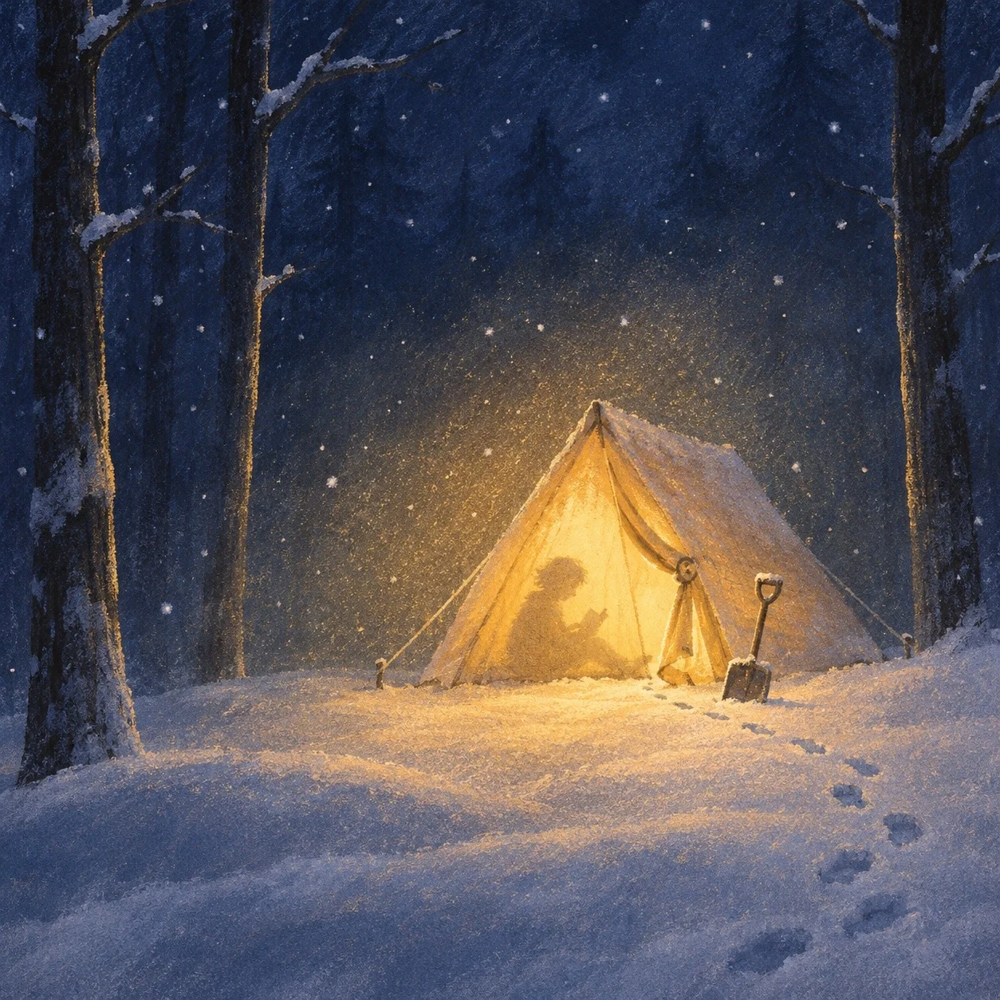

# Grainy Picture-Book Night: A Lit Tent in the Snow

**中文标题：** 颗粒绘本夜景：雪地里亮着的小帐篷  
**ID:** `gi25-x-1657` · **Mode:** `generate`  
**Categories:** `general`  
**Tags:** `x-twitter`, `community`, `gpt-image-2.5`, `x-direct`, `zh`



### Grainy Picture-Book Night: A Lit Tent in the Snow

```text
Create an image with the following visual system. Replace the subject as specified.

Visual system (light, color, composition, medium, mood):
【画面风格】一张方幅 1:1 的数字绘本插画，带明显的颗粒噪点和干刷质感，像用带纹理的笔刷在粗纸上画出来，色块边缘有细碎的颗粒散开，不是光滑矢量，也不是照片。场景是深夜的雪地树林边，机位平视、中景，画面下方约三分之一是一道道柔和起伏的厚雪坡，从左到右缓缓隆起；后面和两侧立着几棵细高的深色树干，树干被画面上边缘裁掉，只看到树干和几根伸进画面的枝条，远处是更暗的树林剪影，糊成一片深蓝。全图唯一的光源是一处暖黄色的小光（由主体决定），它发出的光在周围形成一大团带颗粒的柔和光晕，像空气里飘着细雪和雾，被照亮的地方颗粒变成金色；光落在前面的雪坡上，在雪面上铺出一块蜂蜜黄到奶白的亮面，离光越远雪越快变成灰蓝、再沉进深蓝阴影里，树干朝光的一侧有一道细细的暖色边光。天空和背景是很深的墨蓝和靛蓝，带一层颗粒，夜空里和光晕里零星飘着几十颗小小的白色雪点，大小不一。整体配色：深墨蓝、靛蓝、灰蓝占大部分，暖黄、蜂蜜金、奶白只集中在光源和它照到的那一小片，冷暖对比强但不刺眼。没有人物，或者只有很小的、背对着的痕迹。气氛很静，像所有人都睡了，只剩这一处还亮着。画面里不要任何文字、标志、签名和水印。

New subject:
【主体】雪坡上搭着一顶小小的三角帆布帐篷，帐篷里点着灯，整顶帐篷从里面透出暖黄色的光，帆布上隐约透出一个坐着的小人影；帐篷门帘卷起一角，门口雪地上插着一把小铲子，旁边一串脚印通向画面外。
```

- **Recommended model:** `gpt-image-2.5-flare`
- **Settings:** _(defaults)_
- **Source:** [community](https://x.com/static_stare/status/2125228980681032024) — @static_stare
- **License note:** Original public X post; quoted with attribution — remix with attribution
- **Notes:** Collected directly from X; original post https://x.com/static_stare/status/2125228980681032024; post text names GPT Image 2.5; discovered via X search, prompt re-verified against the original X post via api.fxtwitter.com; verified=True; visual-system + replaceable-subject template; prompt for image 1 of 4 (the author offers the other three on request); post names GPT Image 2.5 without a Flare/Sunburst variant; preview is image 1
- **Preview:** `previews/gi25-x-1657.webp`
