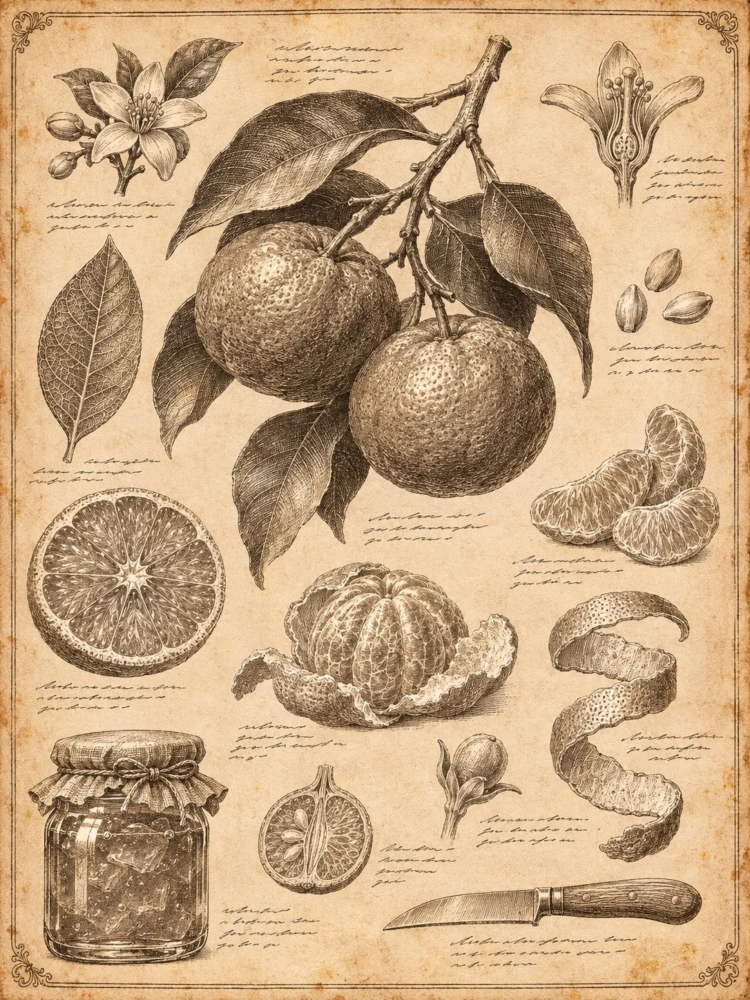

# Antique Natural-History Plate: Citrus Branch and Orange Sections

**中文标题：** 复古博物图版：柑橘枝与剖面  
**ID:** `gi25-x-1661` · **Mode:** `generate`  
**Categories:** `general`  
**Tags:** `x-twitter`, `community`, `gpt-image-2.5`, `x-direct`, `zh`



### Antique Natural-History Plate: Citrus Branch and Orange Sections

```text
Create an image with the following visual system. Replace the subject as specified.

Visual system (light, color, composition, medium, mood):
【画面风格】一张竖幅约 3:4 的复古博物学图版，像从一本十九世纪的老图鉴里撕下来的一页：泛黄发旧的米褐色纸张，边角有一点咖啡色的旧斑和磨损，四周一圈细细的双线边框，四个角带小小的卷草纹饰。所有图案都是黑褐色的铜版画线刻，用密密的排线和交叉线表现明暗与体积，线条细而硬，不上颜色，只有纸本身的暖黄。版式是：画面正中偏上画一个占三分之一页面的大主体（主体由下面决定），细节最多、排线最密；它的四周错落地散布着八到十个小一号的相关小图，有剖面、局部特写、枝叶、种子或果实、相关的小工具，每个小图旁边都有一小段像手写注释一样的墨迹线；左下角固定画一只装着这样东西的旧玻璃罐，罐身有高光和反光线条。小图之间留出均匀的纸面空白，整体疏密有度，像一张认真排过的标本页。所有注释和标题位置都只用细小、不可辨认的手写墨迹线条代替，画面里不要出现任何可读的文字、字母、数字、签名和水印。光线是均匀的平光，像把这页纸平放在桌上正对着拍，没有投影。气氛安静、考究，像能裱起来挂墙。

New subject:
【主体】柑橘：中间是一根挂着两只完整橘子和几片叶子的果枝；四周是橘子的横剖面、剥开的一瓣瓣果肉、橘子花、单片叶子的叶脉、几颗种子、一条螺旋削下来的橘皮、一把小果刀；左下角玻璃罐里装的是橘子酱。
```

- **Recommended model:** `gpt-image-2.5-flare`
- **Settings:** _(defaults)_
- **Source:** [community](https://x.com/static_stare/status/2125524950857695275) — @static_stare
- **License note:** Original public X post; quoted with attribution — remix with attribution
- **Notes:** Collected directly from X; original post https://x.com/static_stare/status/2125524950857695275; post text names GPT Image 2.5; discovered via X search, prompt re-verified against the original X post via api.fxtwitter.com; verified=True; visual-system + replaceable-subject template; prompt for image 1 of 4 (the author offers the other three on request); post names GPT Image 2.5 without a Flare/Sunburst variant; preview is image 1; the plate uses unreadable ink-stroke annotations instead of real lettering
- **Preview:** `previews/gi25-x-1661.webp`
