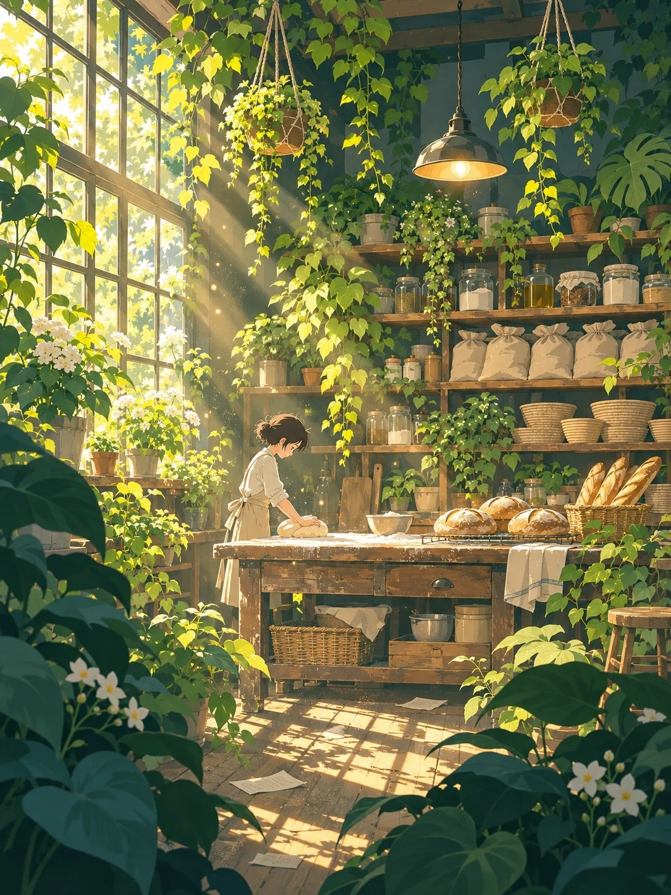

# Sunlit Anime Background: A Tiny Bakery Kitchen

**中文标题：** 阳光动画背景：塞满绿植的小面包房后厨  
**ID:** `gi25-x-1663` · **Mode:** `generate`  
**Categories:** `general`  
**Tags:** `x-twitter`, `community`, `gpt-image-2.5`, `x-direct`, `zh`



### Sunlit Anime Background: A Tiny Bakery Kitchen

```text
Create an image with the following visual system. Replace the subject as specified.

Visual system (light, color, composition, medium, mood):
【画面风格】一张竖幅约 3:4 的日系动画电影背景插画，手绘感的数字绘画，色块边缘干净，叶子用一笔一笔的平涂色块叠出层次，不是 3D，不是照片。画面是一间小小的室内工作间，被大量绿植塞得满满的：天花板吊着一盏金属罩小吊灯和几盆垂下来的藤蔓，墙边一层层木架子上摆着盆栽、玻璃瓶和小罐子。午后的阳光从左上方一大扇格子窗斜射进来，形成几道明显的光柱，照到的叶子变成透亮的黄绿色和柠檬黄，光里飘着细小的浮尘和光点。前景左下和右下压着一圈大片的深绿色叶子，处在阴影里，几乎是暗墨绿，几朵小白花点在里面，让画面有很强的前后纵深。中景是一张旧木工作台，一个小小的人物侧身站在台前专心忙着手里的活（人物和活计由主体决定），人物只占画面很小一部分，穿浅色衣服，被光勾出一道亮边。地板上有阳光投下的窗格亮斑，散着几张纸。整体色调是黄绿、橄榄绿、深墨绿为主，阳光处是暖柠檬黄和奶白，木头是暖棕色，暗部偏蓝绿。气氛安静、明亮、有点忙碌又很治愈，像动画里一个慢镜头。画面里不要任何可读文字和水印。

New subject:
【主体】一间小面包房的后厨：工作台上撒着面粉，摆着刚出炉的圆面包和法棍，一个系着米色围裙、扎着短发的年轻人正低头揉面团，身后架子上除了绿植还有一排面粉袋和发酵篮。
```

- **Recommended model:** `gpt-image-2.5-flare`
- **Settings:** _(defaults)_
- **Source:** [community](https://x.com/static_stare/status/2125560967375556838) — @static_stare
- **License note:** Original public X post; quoted with attribution — remix with attribution
- **Notes:** Collected directly from X; original post https://x.com/static_stare/status/2125560967375556838; post text names GPT Image 2.5; discovered via X search, prompt re-verified against the original X post via api.fxtwitter.com; verified=True; visual-system + replaceable-subject template; prompt for image 1 of 4 (the author offers the other three on request); post names GPT Image 2.5 without a Flare/Sunburst variant; preview is image 1
- **Preview:** `previews/gi25-x-1663.webp`
