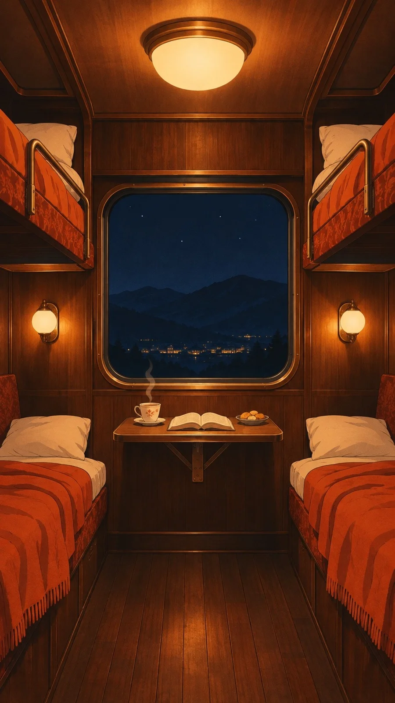

# Retro Anime Night: An Empty Sleeper-Train Compartment

**中文标题：** 复古动画夜景：空无一人的夜行卧铺包厢  
**ID:** `gi25-x-1664` · **Mode:** `generate`  
**Categories:** `general`  
**Tags:** `x-twitter`, `community`, `gpt-image-2.5`, `x-direct`, `zh`



### Retro Anime Night: An Empty Sleeper-Train Compartment

```text
Create an image with the following visual system. Replace the subject as specified.

Visual system (light, color, composition, medium, mood):
【画面风格】一张竖幅约 9:16 的复古日系动画夜景插画，手绘感的数字绘画，线条利落、色块平整，带一点点胶片颗粒，不是 3D，不是照片。画面是一个空无一人的小交通工具车厢内部（具体是什么由主体决定），一点透视、左右基本对称，正对着车厢尽头一扇圆角的大窗。车厢内饰是深色胡桃木的墙板和地板，天花板正中一盏圆形乳白灯罩的顶灯，两侧墙上各有一盏球形小壁灯，全都亮着暖琥珀色的光，在木头上留下柔和的光晕。窗外是深沉的午夜蓝，看得见远处的山或水的轮廓线，和一串细小的暖黄灯点，天上有几颗星，窗外不下雨。窗前是一张小圆桌，桌上一杯热饮冒着一缕细细的白汽，旁边一本摊开的书和一小碟零食。座椅是橙红色带暗纹的软垫，被灯照得发暖。整体是暖琥珀、橙红、深木棕和窗外午夜蓝的强烈冷暖对比，暗部是很深的棕黑色。气氛很安静，夜里只剩这一处亮着，适合一个人坐着发呆。画面里不要人物、文字、标识和水印。

New subject:
【主体】一节夜行列车的双层卧铺包厢：左右两侧是上下铺，铺着橙红色毯子和白枕头，下铺之间是固定在窗下的小折叠桌，桌上放着冒热气的茶和一本书；窗外是远处山脚下的小镇灯火。
```

- **Recommended model:** `gpt-image-2.5-flare`
- **Settings:** _(defaults)_
- **Source:** [community](https://x.com/static_stare/status/2125591906835185851) — @static_stare
- **License note:** Original public X post; quoted with attribution — remix with attribution
- **Notes:** Collected directly from X; original post https://x.com/static_stare/status/2125591906835185851; post text names GPT Image 2.5; discovered via X search, prompt re-verified against the original X post via api.fxtwitter.com; verified=True; visual-system + replaceable-subject template; prompt for image 1 of 4 (the author offers the other three on request); post names GPT Image 2.5 without a Flare/Sunburst variant; preview is image 1
- **Preview:** `previews/gi25-x-1664.webp`
