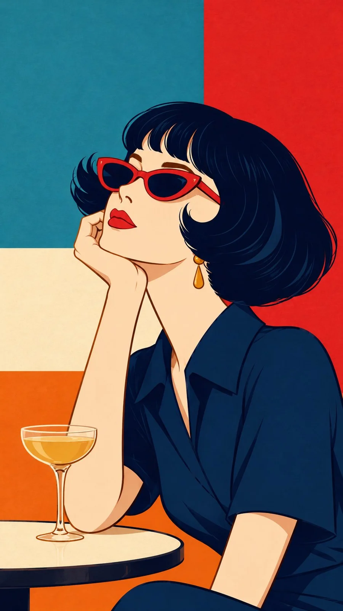

# Vintage Mid-Century Pop-Art Portrait (JSON, 9:16)

**中文标题：** 复古中世纪波普艺术肖像（JSON·9:16）  
**ID:** `gi25-x-1665` · **Mode:** `generate`  
**Categories:** `general`  
**Tags:** `x-twitter`, `community`, `gpt-image-2.5`, `x-direct`, `en`



### Vintage Mid-Century Pop-Art Portrait (JSON, 9:16)

```text
{
"aspect_ratio": "9:16",
"prompt": "Create a stylish vintage retro pop-art illustration featuring an elegant woman with a short, voluminous dark navy blue bob haircut and soft wavy bangs. Her face is tilted slightly upward and sideways, with eyes gently closed, dramatic red eyeshadow, thin black eyeliner, natural orange eyebrows, a small delicate nose, and bold red lips. She has a calm, confident, sophisticated expression. Her skin is smooth warm ivory cream. Add a small orange dangling earring. She is wearing a dark navy blue high-neck outfit and holding a long vertical orange cigarette holder or slim decorative stick gracefully between her fingers. Her hand should have elegant, elongated fingers and minimalist shapes. Background consists of bold geometric rectangular blocks in vibrant red, teal blue, burnt orange, and warm ivory cream. Use a mid-century modern editorial illustration aesthetic, 1960s French fashion art, flat vector art, clean smooth shapes, minimal shading, strong color blocking, crisp outlines, sophisticated color palette, screen-print texture, elegant composition, and timeless retro graphic design. Full vertical composition, visually balanced, high-end art print quality. Absolutely no typography or text anywhere in the image.",
"negative_prompt": "any text, letters, words, typography, captions, logos, labels, numbers, watermarks, signatures, photorealistic, 3D render, realistic skin texture, excessive details, gradients, blurry lines, messy anatomy, extra fingers, deformed hands, asymmetrical eyes, bad proportions, cluttered background",
"style": "Vintage Mid-Century Pop Art",
"quality": "high"
}
```

- **Recommended model:** `gpt-image-2.5-flare`
- **Settings:** _(defaults)_
- **Source:** [community](https://x.com/Just_Anika_Here/status/2125609318192132433) — @Just_Anika_Here
- **License note:** Original public X post; quoted with attribution — remix with attribution
- **Notes:** Collected directly from X; original post https://x.com/Just_Anika_Here/status/2125609318192132433; post text names GPT Image 2.5; discovered via X search, prompt re-verified against the original X post via api.fxtwitter.com; verified=True; JSON prompt as posted; post names GPT Image 2.5 without a Flare/Sunburst variant; aspect_ratio in the JSON is 9:16; preview is image 1 of 2
- **Preview:** `previews/gi25-x-1665.webp`
