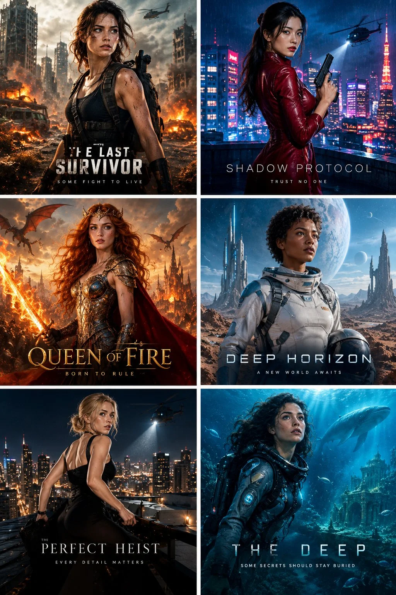

# Six Hollywood Movie Posters in a 2x3 Grid

**中文标题：** 六张好莱坞电影海报 2×3 宫格  
**ID:** `gi25-x-1666` · **Mode:** `generate`  
**Categories:** `general`  
**Tags:** `x-twitter`, `community`, `gpt-image-2.5`, `x-direct`, `en`



### Six Hollywood Movie Posters in a 2x3 Grid

```text
Create a premium collection of SIX different Hollywood movie posters arranged in an exact 2-column × 3-row grid.

Each panel must feature a completely different adult female protagonist, unique face, hairstyle, outfit, action pose, movie genre, and cinematic environment.

Six Movie Concepts:

Action: Fierce female warrior in a burning futuristic city.
Spy Thriller: Female secret agent on a neon-lit Tokyo rooftop.
Fantasy: Powerful warrior queen with a flaming sword and dragons.
Sci-Fi: Female astronaut exploring a mysterious alien planet.
Crime Thriller: Female master thief escaping a luxury skyscraper.
Underwater Adventure: Female explorer discovering an ancient sunken civilization.

Visual Style: Epic Hollywood blockbuster movie posters, dramatic action poses, breathtaking environments, cinematic lighting, rich colors, photorealistic characters, premium theatrical poster design.

Layout: Exactly six separate posters, 2 columns × 3 rows, equal-sized panels, clean spacing, perfectly aligned.

IMPORTANT: Six completely different heroines, six different movie worlds. Every panel must look like an individual blockbuster movie poster. No repeated faces, outfits, or backgrounds. Ultra-realistic, exceptionally detailed, 8K quality.
```

- **Recommended model:** `gpt-image-2.5-flare`
- **Settings:** _(defaults)_
- **Source:** [community](https://x.com/Just_Anika_Here/status/2125627017622323425) — @Just_Anika_Here
- **License note:** Original public X post; quoted with attribution — remix with attribution
- **Notes:** Collected directly from X; original post https://x.com/Just_Anika_Here/status/2125627017622323425; post text names GPT Image 2.5; discovered via X search, prompt re-verified against the original X post via api.fxtwitter.com; verified=True; post names GPT Image 2.5 without a Flare/Sunburst variant
- **Preview:** `previews/gi25-x-1666.webp`
