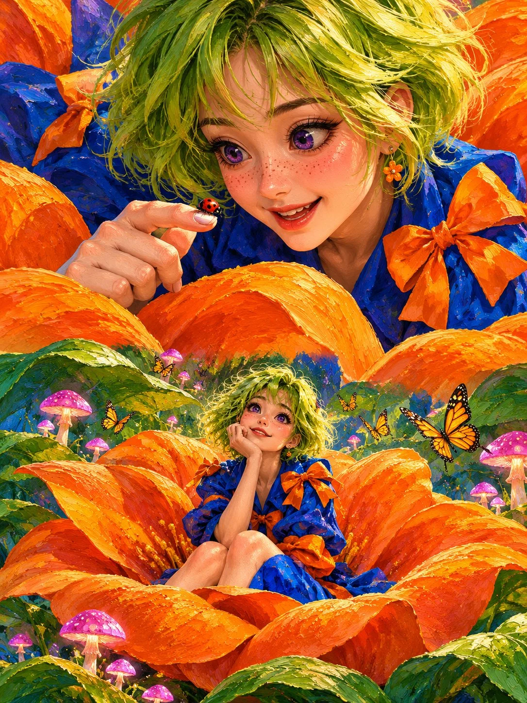

# Surreal Oil Painting: Woman in a Giant Orange Flower (JSON, 3:4)

**中文标题：** 超现实油画：坐在巨大橙花里的女孩（JSON·3:4）  
**ID:** `gi25-x-1669` · **Mode:** `generate`  
**Categories:** `general`  
**Tags:** `x-twitter`, `community`, `gpt-image-2.5`, `x-direct`, `en`



### Surreal Oil Painting: Woman in a Giant Orange Flower (JSON, 3:4)

```text
{
  "aspect_ratio": "3:4",
  "prompt": "Create a breathtaking Japanese anime-inspired surreal oil painting featuring a playful young adult Japanese woman with short lime-green hair, oversized expressive violet eyes, round rosy cheeks, unusual tiny freckles and a mischievous smile. She is sitting gracefully inside the heart of an impossibly enormous blooming orange flower, surrounded by gigantic overlapping orange petals that frame her face beautifully. She leans forward playfully, holding a tiny ladybug on her fingertip while looking directly at it with curious fascination. Enormous lush green leaves curve around the flower, with miniature glowing pink mushrooms, delicate butterflies and tiny floating pollen particles scattered throughout the magical environment. Use an imaginative slightly elevated three-quarter camera angle, creating beautiful depth and a captivating composition. She wears a vivid cobalt-blue outfit decorated with oversized orange bows that contrast beautifully against the lime-green foliage and orange petals. Vibrant orange, cobalt blue, lime green, violet and pink color palette. Rich traditional oil painting technique, thick expressive textured brush strokes, whimsical surrealism, bold color blocking, intricate painterly details, extraordinary artistic atmosphere, highly imaginative premium editorial illustration. Single continuous composition, one scene, no panels, no borders, no split screen, no text, no watermark."
}
```

- **Recommended model:** `gpt-image-2.5-flare`
- **Settings:** _(defaults)_
- **Source:** [community](https://x.com/Just_Anika_Here/status/2125779071837585465) — @Just_Anika_Here
- **License note:** Original public X post; quoted with attribution — remix with attribution
- **Notes:** Collected directly from X; original post https://x.com/Just_Anika_Here/status/2125779071837585465; post text names GPT Image 2.5; discovered via X search, prompt re-verified against the original X post via api.fxtwitter.com; verified=True; JSON prompt as posted; post names GPT Image 2.5 without a Flare/Sunburst variant; aspect_ratio in the JSON is 3:4
- **Preview:** `previews/gi25-x-1669.webp`
