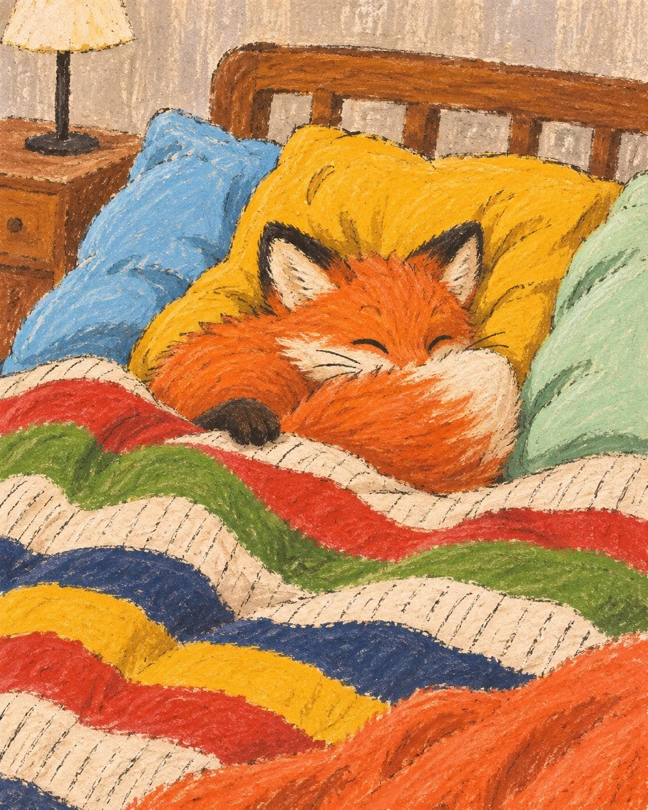

# Grainy Gouache: A Fox Napping Under a Striped Quilt

**中文标题：** 粗颗粒蜡笔画：钻被窝睡觉的小狐狸  
**ID:** `gi25-x-1670` · **Mode:** `generate`  
**Categories:** `general`  
**Tags:** `x-twitter`, `community`, `gpt-image-2.5`, `x-direct`, `zh`



### Grainy Gouache: A Fox Napping Under a Striped Quilt

```text
Create an image with the following visual system. Replace the subject as specified.

Visual system (light, color, composition, medium, mood):
【画面风格】一张竖幅约 4:5 的手绘插画，像用不透明水粉和油画棒画在粗纹纸上，笔触发干、颗粒很粗，色块边缘毛毛糙糙地蹭开，露出底下的纸纹，再用细细的黑色蜡笔线随手勾几笔轮廓、胡须和布褶，线条有断有续，不是数字平涂，不是 3D，也不是照片。场景是白天卧室里的一张床，机位略高、斜着往下看床头，近景。一只小动物（由主体决定）窝在床上睡着了，脑袋陷在枕头堆里，身子埋在被子下面，闭着眼，眼睛画成两道弯弯的短黑线，表情很满足。床头堆着三个大枕头：左边天蓝色，中间芥末黄，右边浅薄荷绿，用大块平涂加几道深一号的阴影色块。被子是一床粗条纹的毯子，一道一道是番茄红、草绿、米白、藏青和芥末黄，米白的条纹里用细黑线排出布纹，被子高低起伏，占满画面下半部分，前景一角露出一团橙红色的被角。左上角是一个木头床头柜和一根黑色细灯杆，后面是米灰色的墙，用干刷的竖向笔触扫出来。光是中午从窗外进来的柔和日光，基本是平光，没有明显的投影方向，只靠色块的冷暖分出前后。整体是米白和暖灰的底，上面压着高饱和的红、黄、蓝、绿色块，颜色很纯，但因为颗粒感显得很软。气氛暖、懒、安心，像中午偷偷补一觉。画面里不要人物、文字、签名和水印。

New subject:
【主体】一只小赤狐，橙红色的毛、白色的下巴和黑色的耳尖，蜷成一个圈睡在芥末黄枕头前面，蓬松的大尾巴绕过来盖住鼻子，一只黑色的小前爪搭在被子边上。
```

- **Recommended model:** `gpt-image-2.5-flare`
- **Settings:** _(defaults)_
- **Source:** [community](https://x.com/static_stare/status/2125812239039095076) — @static_stare
- **License note:** Original public X post; quoted with attribution — remix with attribution
- **Notes:** Collected directly from X; original post https://x.com/static_stare/status/2125812239039095076; post text names GPT Image 2.5; discovered via X search, prompt re-verified against the original X post via api.fxtwitter.com; verified=True; visual-system + replaceable-subject template; prompt for image 1 of 4 (the author offers the other three on request); post names GPT Image 2.5 without a Flare/Sunburst variant; preview is image 1
- **Preview:** `previews/gi25-x-1670.webp`
