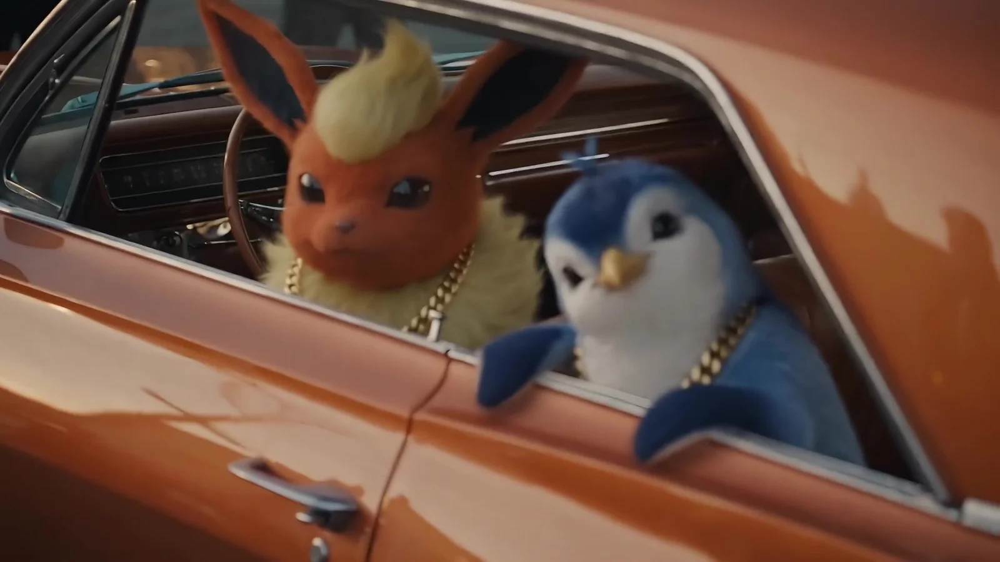

# Cinematic Film Still: Flareon and Piplup in a Lowrider

**中文标题：** 电影剧照：坐在低底盘车上的火精灵与波加曼  
**ID:** `gi25-x-1676` · **Mode:** `generate`  
**Categories:** `general`  
**Tags:** `x-twitter`, `community`, `gpt-image-2.5`, `x-direct`, `en`



### Cinematic Film Still: Flareon and Piplup in a Lowrider

```text
Cinematic live-action film still, a close handheld two-shot from outside a glossy burnt-orange 1960s lowrider sedan with the windows down. The camera sits level with the window line, and the chrome-trimmed door and rear quarter panel fill the lower half and right edge of the frame.
A realistic Flareon with dense orange fur, a fluffy cream mane and a cream pompadour tuft sits behind a thin wood-rim steering wheel. It wears a chunky gold Cuban-link chain with a bar pendant and gives the lens a cool closed-mouth smirk.
In the foreground, a realistic Piplup with velvety blue and white down and a golden beak leans out of the open window. Both flippers are draped over the door sill, its head is tilted toward camera, and it wears a gold Cuban-link chain around its neck.
Inside is a vintage wood-tone dashboard with a horizontal speedometer, sitting in warm shadow.
The light is soft, warm late-afternoon sun from camera-left, glowing on the glossy paint and fur, with dark tree reflections sliding across the rear quarter panel.
Shallow depth of field, slight motion softness, anamorphic lens, 35mm film grain, lifted blacks, hip-hop music video energy. Photoreal creature fur, not CGI, no plush look, no text.
```

- **Recommended model:** `gpt-image-2.5-flare`
- **Settings:** _(defaults)_
- **Source:** [community](https://x.com/OzairAkhtar5/status/2125893193283883470) — @OzairAkhtar5
- **License note:** Original public X post; quoted with attribution — remix with attribution
- **Notes:** Collected directly from X; original post https://x.com/OzairAkhtar5/status/2125893193283883470; post text names GPT Image 2.5; discovered via X search, prompt re-verified against the original X post via api.fxtwitter.com; verified=True; still-image keyframe prompt as posted; the author names GPT Image 2.5 Flare; later replies describe a Seedance video step that is not included
- **Preview:** `previews/gi25-x-1676.webp`
