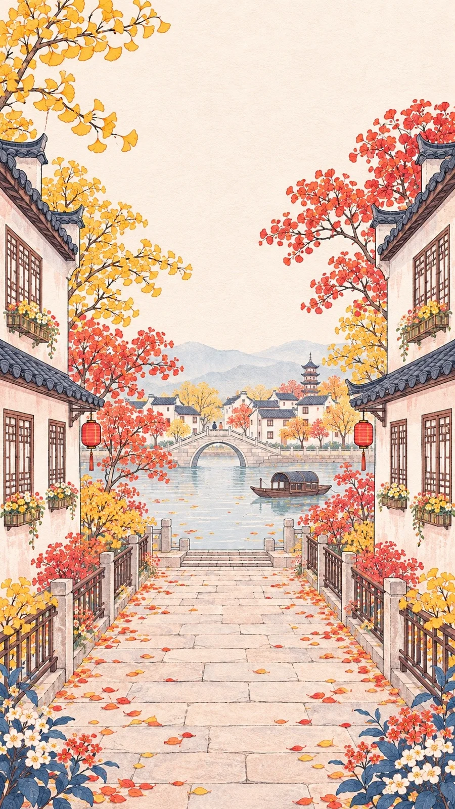

# Decorative Autumn Town: Jiangnan Waterside (Visual System)

**中文标题：** 平面装饰秋景：江南水乡（画面风格模板）  
**ID:** `gi25-x-1678` · **Mode:** `generate`  
**Categories:** `general`  
**Tags:** `x-twitter`, `community`, `gpt-image-2.5`, `x-direct`, `zh`



### Decorative Autumn Town: Jiangnan Waterside (Visual System)

```text
Create an image with the following visual system. Replace the subject as specified.

Visual system (light, color, composition, medium, mood):
【画面风格】一张竖幅约 9:16 的平面装饰风插画，像手绘水粉加细线的绘本海报，平涂色块，用细细的深蓝黑线勾窗框、屋檐和栏杆，树叶和花用一点一点的小笔触点出来，带一点纸面颗粒，不是 3D，不是照片，没有写实光影。构图左右对称、一点透视：画面正中一条浅米色的石板路从下边缘往上延伸，越远越窄，一直通到水边；路两侧是对称的高高的房子，靠画面边缘的房子被裁掉一半，墙面以白色、米白和浅粉为主，窗户整齐排列，窗台上摆着小花箱；房子之间和路边种着一棵棵秋天的树，树冠是红、橙、姜黄、浅金几种颜色，用小叶片点出来，路面和路边散落着红橙色的落叶。画面中部是一片浅灰蓝的水面，水上有一两只小船，远处是对岸的一排小楼和尖顶，再远是很淡的山影。画面上方约三分之一是几乎留白的米白天空。前景两个下角各有一丛装饰性的小花和深蓝色叶子，像镶了一道边。光是柔和的漫射光，没有明显投影。整体配色：米白、白、浅灰蓝打底，红、橙、姜黄、金色的秋叶做主角，深蓝黑的细线和少量深蓝叶子压住画面，干净、明亮、不脏。人物很少，只是远处几个小点。气氛安静、清爽，像秋天一个人慢慢走到水边。画面里不要任何文字、标志、签名和水印。

New subject:
【主体】江南水乡的秋天：两侧是白墙黛瓦的老房子，木格窗，屋檐下挂着两盏小红灯笼；路边是金黄的银杏和红色的乌桕，石板路通向一座小石拱桥和河埠头，水上停着一条乌篷船，对岸是一排白墙和一座小宝塔。
```

- **Recommended model:** `gpt-image-2.5-flare`
- **Settings:** _(defaults)_
- **Source:** [community](https://x.com/static_stare/status/2125924762904105073) — @static_stare
- **License note:** Original public X post; quoted with attribution — remix with attribution
- **Notes:** Collected directly from X; original post https://x.com/static_stare/status/2125924762904105073; post text names GPT Image 2.5; discovered via X search, prompt re-verified against the original X post via api.fxtwitter.com; verified=True; visual-system + replaceable-subject template; prompt for image 1 of 4 (the author offers the other three on request); post names GPT Image 2.5 without a Flare/Sunburst variant; preview is image 1
- **Preview:** `previews/gi25-x-1678.webp`
