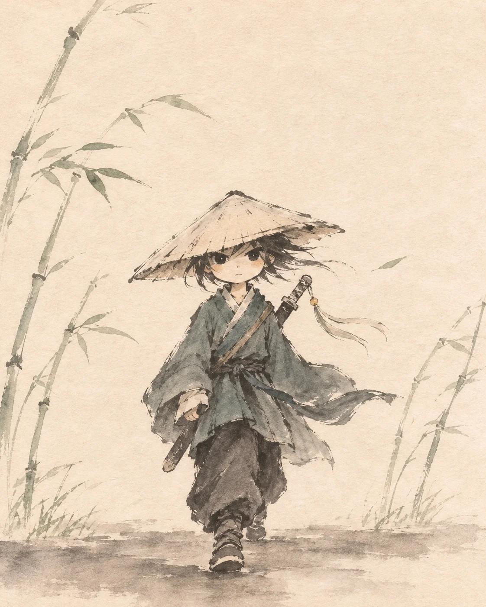

# Ink-Wash Journey: Swordsman on a Bamboo Path (Visual System)

**中文标题：** 水墨淡彩行路：竹林小道上的青衣剑客（画面风格模板）  
**ID:** `gi25-x-1679` · **Mode:** `generate`  
**Categories:** `general`  
**Tags:** `x-twitter`, `community`, `gpt-image-2.5`, `x-direct`, `zh`



### Ink-Wash Journey: Swordsman on a Bamboo Path (Visual System)

```text
Create an image with the following visual system. Replace the subject as specified.

Visual system (light, color, composition, medium, mood):
【画面风格】一张竖幅约 4:5 的手绘插画，画在偏暖的米白宣纸上，像传统水墨淡彩：先用浓淡不均的黑墨以书法用笔轻松勾轮廓，线条有飞白、有断开、有粗有细，不是闭合的矢量线，也不是光滑的数字平涂、3D 或照片。淡彩只轻轻罩在墨线里，水色会在纸上洇开一点，干笔扫过的地方能看出纸纹。构图是全身中近景，人物大约站在画面正中略偏下，平视或略偏低的机位，头顶和左右留出大片空白的宣纸，空才像这口气。人物比例略带一点写意的少年感，头稍大，五官极简：眼睛是两团深墨色的大眼睛，只有一点点高光，鼻子和嘴只是很小的墨点或短线，表情安静，略带一点倔。头发用几组方向一致的飞白墨线画出被风吹乱的感觉。身上是中式行路的交领宽袖衣裳，衣褶用淡墨扫，衣摆和袖口被同一侧的风吹起来。动作是走路或轻轻站住，不是打斗，兵器如果出现必须入鞘，手画得简单，袖口可以挡住一部分，五指不要又长又分叉。脚下是一条横向的淡墨地面，墨色往上慢慢变浅，溶进纸色。人物周围有被风吹向同一侧的植物，具体种类由主体决定，用干笔和极淡的青绿色或墨灰色扫出来，不要画满，不要画成写实密林。光线是宣纸上的柔和平光，几乎没有硬投影，体积靠墨色的浓淡。整体色调是米白纸色加大面积墨灰，只有一点点淡青绿或淡赭石，再由主体带一个很小的暖色点。气氛清、静，像一个人走在路上，不是侠客对打，也不是仙侠大场景。画面里不要文字、印章、签名和水印，不要血腥，不要原图里那种飞在空中的小虫子。

New subject:
【主体】一个青衣斗笠剑客走在竹林小道上。深青灰色的交领短褂，宽裤是更深的墨色，头上戴一顶浅色的斗笠，帽檐压着一点脸，背后斜背一把入鞘的长剑，浅色剑穗随风轻轻扬起。身边只画近处几竿被风吹斜的淡青竹子和几片竹叶，远处留白。脚下是湿润的淡墨土路。
```

- **Recommended model:** `gpt-image-2.5-flare`
- **Settings:** _(defaults)_
- **Source:** [community](https://x.com/static_stare/status/2125939195445379237) — @static_stare
- **License note:** Original public X post; quoted with attribution — remix with attribution
- **Notes:** Collected directly from X; original post https://x.com/static_stare/status/2125939195445379237; post text names GPT Image 2.5; discovered via X search, prompt re-verified against the original X post via api.fxtwitter.com; verified=True; visual-system + replaceable-subject template; prompt for image 1 of 4 (the author offers the other three on request); post names GPT Image 2.5 without a Flare/Sunburst variant; preview is image 1
- **Preview:** `previews/gi25-x-1679.webp`
