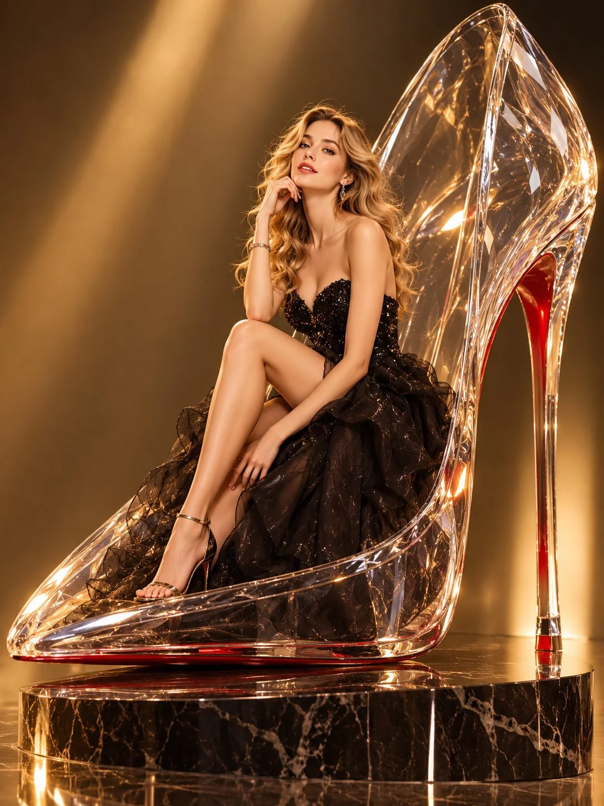

# Surreal Fashion: A Mansion Built Into a Giant Heel (JSON, 3:4)

**中文标题：** 超现实时尚：巨型高跟鞋里的豪宅（JSON·3:4）  
**ID:** `gi25-x-1681` · **Mode:** `generate`  
**Categories:** `general`  
**Tags:** `x-twitter`, `community`, `gpt-image-2.5`, `x-direct`, `en`



### Surreal Fashion: A Mansion Built Into a Giant Heel (JSON, 3:4)

```text
{
  "aspect_ratio": "3:4",
  "style": "Ultra-realistic luxury fashion editorial, surreal high-fashion commercial photography, cinematic 8K",

  "prompt": "Create an extraordinary surreal luxury fashion advertisement featuring a stunning adult European female fashion model sitting gracefully INSIDE an enormous transparent crystal-glass high-heel shoe. The giant stiletto shoe should be the central attraction, dramatically oversized compared to the human model. Design the shoe with perfectly transparent crystal glass, a glossy deep ruby-red sole, elegant pointed toe, delicate reflections and sparkling glass details. The beautiful model has refined European editorial features, flawless natural-looking skin, elegant blonde hair styled in soft waves, sophisticated makeup and a confident expression. She wears an expensive black couture evening gown with a dramatic flowing silhouette and delicate sparkling embellishments. Her sitting pose should look natural, elegant and fashion-forward, with realistic body proportions. The giant transparent heel rests on a premium black marble platform. Surround the composition with dramatic warm golden studio lighting, subtle reflections, deep shadows and a sophisticated luxury atmosphere. Use a slightly low three-quarter camera angle to emphasize the enormous scale of the shoe. The entire shoe must remain visible within the frame, with the model clearly visible inside it. The final result should resemble an exclusive European luxury fashion house campaign, visually surprising, breathtaking, highly detailed and photorealistic.",

  "negative_prompt": "cartoon, anime, illustration, low quality, blurry face, distorted anatomy, extra fingers, extra legs, duplicate model, deformed shoes, opaque shoe, miniature shoe, floating body, unnatural sitting pose, cropped high heel, messy background, cheap plastic appearance, text, watermark, logo",

  "composition": {
    "aspect_ratio": "3:4",
    "orientation": "portrait",
    "camera_angle": "low three-quarter angle",
    "subject_position": "center",
    "lighting": "cinematic golden studio lighting",
    "visual_priority": "giant transparent high heel and female model"
  },

  "quality": "Ultra-detailed, photorealistic, 8K"
}
```

- **Recommended model:** `gpt-image-2.5-flare`
- **Settings:** _(defaults)_
- **Source:** [community](https://x.com/Just_Anika_Here/status/2125960268501127246) — @Just_Anika_Here
- **License note:** Original public X post; quoted with attribution — remix with attribution
- **Notes:** Collected directly from X; original post https://x.com/Just_Anika_Here/status/2125960268501127246; post text names GPT Image 2.5; discovered via X search, prompt re-verified against the original X post via api.fxtwitter.com; verified=True; JSON prompt as posted; post names GPT Image 2.5 without a Flare/Sunburst variant; aspect_ratio in the JSON is 3:4
- **Preview:** `previews/gi25-x-1681.webp`
