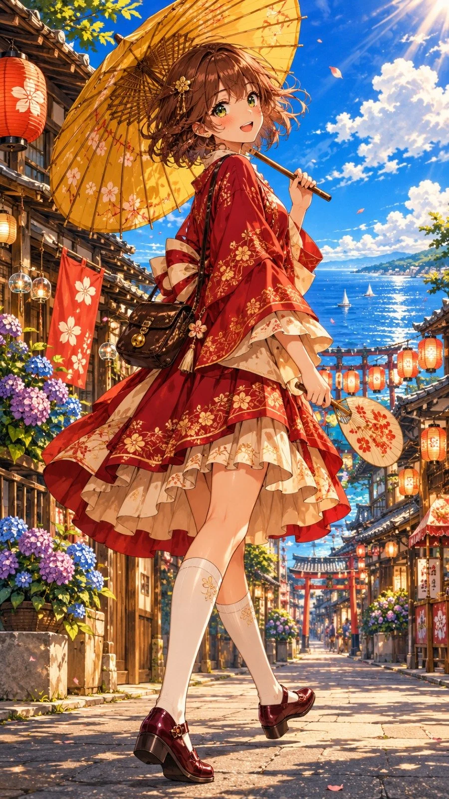

# Anime Summer Festival Street: Fashionable Girl (JSON, 9:16)

**中文标题：** 日系夏日祭街道：时尚少女（JSON·9:16）  
**ID:** `gi25-x-1687` · **Mode:** `generate`  
**Categories:** `general`  
**Tags:** `x-twitter`, `community`, `gpt-image-2.5`, `x-direct`, `en`



### Anime Summer Festival Street: Fashionable Girl (JSON, 9:16)

```text
{
  "aspect_ratio": "9:16",
  "style": "Premium Japanese anime movie illustration, vibrant summer festival aesthetic, expressive hand-drawn character art, rich complementary colors, cinematic cel shading",

  "prompt": "Create an extraordinarily beautiful Japanese anime summer movie illustration featuring an original fashionable anime girl walking through a picturesque traditional Japanese seaside festival street.

CHARACTER: A charming young adult anime girl with short, fluffy chestnut-brown hair, soft golden highlights, slightly messy bangs and two tiny side braids. Large expressive emerald-green eyes, delicate facial features, naturally blushing cheeks and a playful mischievous smile. Her hair moves gently in the summer breeze.

OUTFIT: A stylish oversized cherry-red and warm cream Japanese-inspired summer dress with layered fabric, wide flowing sleeves, subtle golden floral embroidery and a beautiful pleated skirt. A small dark brown leather shoulder bag with decorative charms. White knee-high socks and elegant dark burgundy Mary Jane shoes. A tiny golden hair accessory adds personality. The outfit must look fashionable, colorful and visually distinctive.

POSE: Full-body walking pose, captured from a slightly low three-quarter camera angle. She holds an elegant open mustard-yellow Japanese paper umbrella over one shoulder while looking back toward the viewer. Her free hand holds a small festival paper fan. Her skirt and hair move naturally with the breeze. One foot is lifted slightly mid-step, creating a lively and graceful silhouette.

ENVIRONMENT: A beautiful traditional Japanese seaside festival street with charming wooden shops, colorful hanging paper lanterns, red decorative banners, flower arrangements and distant glimpses of sparkling blue ocean. Small petals drift through the air. A few tiny festival decorations add depth without making the background crowded.

SKY AND LIGHTING: Brilliant summer afternoon sky with rich cobalt-blue tones and soft white clouds. Warm golden sunlight enters diagonally from the upper right, creating luminous highlights on her hair, umbrella and flowing dress. Beautiful sunlight reflections and soft atmospheric shadows.

COLOR PALETTE: Cherry red, mustard yellow, warm cream, chestnut brown, emerald green, cobalt blue and golden sunlight. Strong but balanced complementary colors. The character must stand out clearly from the environment.

COMPOSITION: Vertical 9:16 full-body composition. Show the complete character from head to shoes without cropping. Character occupies approximately 65 percent of the frame. Slightly low camera perspective, beautiful foreground depth, detailed festival street behind her and clear separation between character and background.

ARTISTIC QUALITY: Exceptional Japanese theatrical anime movie artwork, intricate hand-drawn linework, beautifully rendered expressive eyes, detailed individual hair strands, sophisticated cel shading, painterly background, rich fabric textures, natural anatomy, cinematic lighting and premium animation-art finish.

MOOD: Playful, adventurous, refreshing, joyful and nostalgic. A beautiful unforgettable summer festival moment captured from an iconic Japanese animated movie.

Make the artwork visually breathtaking, vibrant, polished, highly detailed and original.",

  "negative_prompt": "photorealistic, 3D render, CGI, dull colors, washed-out palette, flat lighting, boring outfit, generic character, stiff pose, cropped body, cut-off shoes, close-up portrait, bad anatomy, extra fingers, extra limbs, deformed hands, distorted face, asymmetrical eyes, messy hair, duplicated objects, overcrowded background, excessive decorations, text, typography, watermark, logo, border"
}
```

- **Recommended model:** `gpt-image-2.5-flare`
- **Settings:** _(defaults)_
- **Source:** [community](https://x.com/hey_am_cherry/status/2126174912444588496) — @hey_am_cherry
- **License note:** Original public X post; quoted with attribution — remix with attribution
- **Notes:** Collected directly from X; original post https://x.com/hey_am_cherry/status/2126174912444588496; post text names GPT Image 2.5; discovered via X search, prompt re-verified against the original X post via api.fxtwitter.com; verified=True; JSON prompt as posted; post names GPT Image 2.5 without a Flare/Sunburst variant; aspect_ratio in the JSON is 9:16; preview is image 1 of 2
- **Preview:** `previews/gi25-x-1687.webp`
