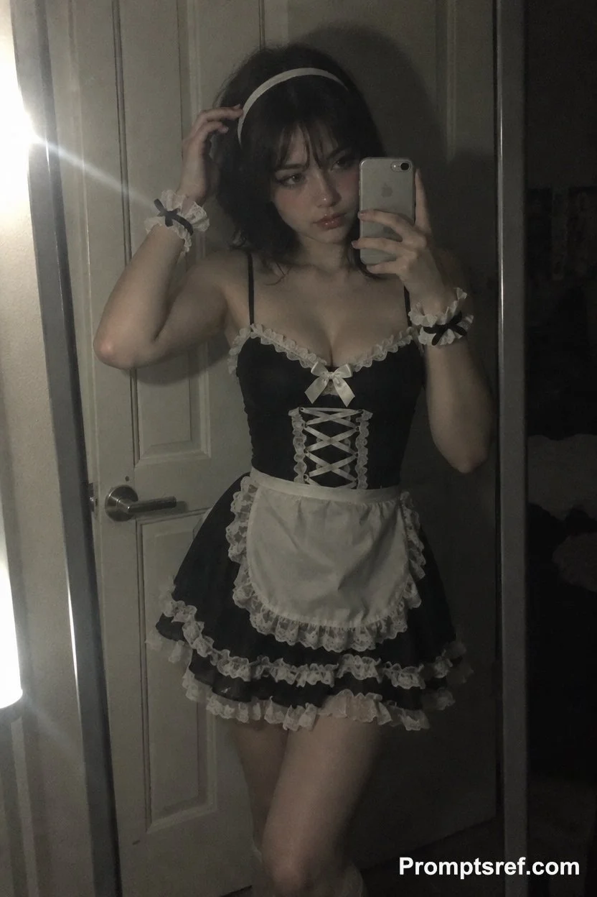

# Vertical 3:4 Mirror Selfie with an Old-Phone Look

**中文标题：** 旧手机质感的 3:4 竖版镜前自拍  
**ID:** `gi25-x-1689` · **Mode:** `generate`  
**Categories:** `general`  
**Tags:** `x-twitter`, `community`, `gpt-image-2.5`, `x-direct`, `en`



### Vertical 3:4 Mirror Selfie with an Old-Phone Look

```text
A vertical 3:4 mirror selfie with the look of an older smartphone camera. In a dim room, a young adult woman stands in front of a gray, narrow-framed full-length mirror. The mirror tilts slightly in the frame, with her reflection just right of center and cropped around the knees. She has a near-black jaw-length bob, wispy bangs, a thin white headband, dark upper eyeliner, blush diffused under the eyes, and glossy muted rose lips. On image-right, she holds a rounded silver single-camera phone upright, covering a small part of her cheek. On image-left, her elbow is bent and her fingertips linger beside the headband as if she has just adjusted it. Her gaze is already back on the phone screen. She rests her weight on one leg, with the opposite knee bent slightly forward.

Her black, thin-strapped maid-style cosplay dress has an ivory lace neckline, a small white bow, white crisscross bodice lacing, a lightly creased apron, layered lace at the skirt hem, and ruffled wrist cuffs. Behind her reflection is a pale gray-beige paneled door with a horizontal silver lever handle low on the left. A blown-out vertical light at the far left sends a thin diagonal flare across the mirror frame and her raised forearm. The phone and her head cast shadows on the door, and the right side of the room falls into deep shadow. Keep the muted gray-green cast, visible low-light sensor grain, slightly soft edges, and uneven exposure of a casual outfit photo from a phone camera roll.
```

- **Recommended model:** `gpt-image-2.5-flare`
- **Settings:** _(defaults)_
- **Source:** [community](https://x.com/underwoodxie96/status/2126211690522116300) — @underwoodxie96
- **License note:** Original public X post; quoted with attribution — remix with attribution
- **Notes:** Collected directly from X; original post https://x.com/underwoodxie96/status/2126211690522116300; post text names GPT Image 2.5; discovered via X search, prompt re-verified against the original X post via api.fxtwitter.com; verified=True; prompt as posted; the author asks the viewer to guess which of the two images is GPT Image 2.5; post names GPT Image 2.5 without a Flare/Sunburst variant; preview is image 1 of 2
- **Preview:** `previews/gi25-x-1689.webp`
