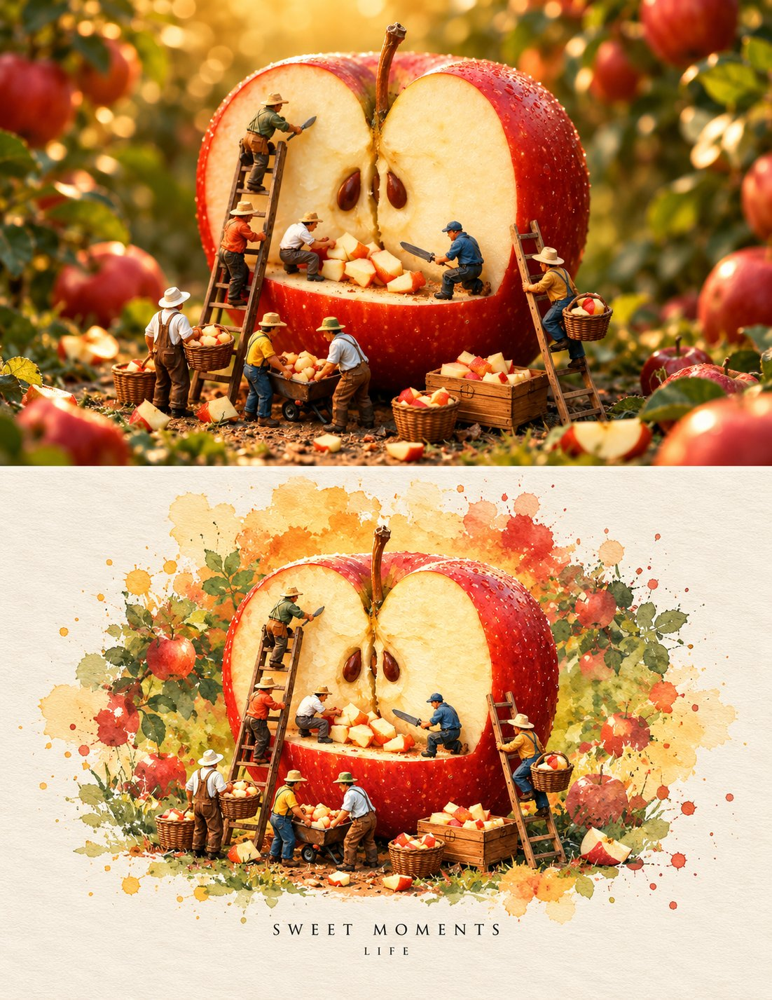

# Miniature World Inside a Giant Sliced Apple

**中文标题：** 巨型切开苹果里的微缩世界  
**ID:** `gi25-x-714` · **Mode:** `generate`  
**Categories:** `general`  
**Tags:** `x-twitter`, `community`, `gpt-image-2.5`, `x-direct`, `en`



### Miniature World Inside a Giant Sliced Apple

```text
A whimsical miniature world built around a giant freshly cut red apple in an apple orchard. The enormous apple is sliced perfectly in half and standing upright, revealing its creamy golden-white flesh, central core, seeds, and wooden stem. Tiny miniature apple farmers are actively harvesting and cutting the apple: some workers are climbing wooden ladders, others are standing on the apple’s surface slicing small apple pieces with knives, while others collect the freshly cut apple chunks into woven wicker baskets and rustic wooden crates. Several tiny farmers wear colorful work clothes, hats, boots, and overalls, creating a charming handcrafted miniature farming scene.
Surround the giant apple with a lush apple orchard filled with red apples, green leaves, branches, grass, fallen apple pieces, wooden crates, baskets, and tiny farming tools. Warm golden sunlight shines through the trees, creating a magical cinematic atmosphere with soft glowing bokeh in the background.
Create two visual treatments of the same scene: the first as an ultra-realistic cinematic miniature photography scene with realistic textures, detailed workers, glossy red apple skin, natural lighting, shallow depth of field and macro photography; the second as a beautiful vintage watercolor illustration / handmade travel scrapbook artwork, painted on warm textured cream paper, with delicate watercolor washes, visible brush strokes, colorful paint splashes, soft botanical apple branches, artistic imperfections, and a cozy storybook aesthetic.
The composition should feel charming, imaginative, nostalgic, and handcrafted, like a premium illustrated children's storybook or vintage travel scrapbook. Highly detailed miniature characters, realistic proportions, intricate baskets and wooden ladders, warm autumn color palette, soft natural shadows, cinematic depth, beautiful composition, vertical poster layout, centered subject, clean cream paper border.
At the bottom of the watercolor version, add elegant minimalist typography reading “SWEET MOMENTS” and underneath “LIFE”, with refined black serif lettering and generous spacing.
Photorealistic miniature photography + whimsical fantasy + vintage watercolor illustration + premium scrapbook aesthetic + ultra-detailed + warm golden lighting + macro depth of field + highly intricate textures.
```

- **Recommended model:** `gpt-image-2.5-sunburst`
- **Settings:** _(defaults)_
- **Source:** [community](https://x.com/mehwishkiran07/status/2107803596477944202) — @mehwishkiran07
- **License note:** Original public X post; quoted with attribution — remix with attribution
- **Notes:** Collected directly from X; prompt posted as the author's reply https://x.com/mehwishkiran07/status/2107803596477944202 to https://x.com/mehwishkiran07/status/2107803591281168600, which carries the images and names GPT Image 2.5; discovered via Bin0754/gpt-image-gallery index, prompt re-verified against the original X post; verified=True; first of several prompts the author posted in the thread
- **Preview:** `previews/gi25-x-714.jpg`
