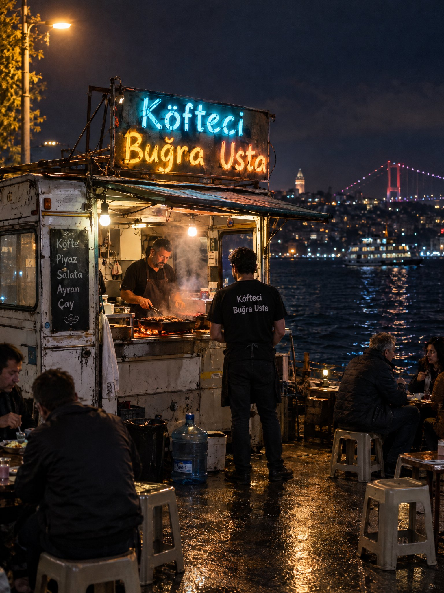

# Istanbul Bosphorus Night Köfte Stall Street Photo

**中文标题：** 伊斯坦布尔博斯普鲁斯夜色肉丸小摊街拍  
**ID:** `gi25-x-716` · **Mode:** `generate`  
**Categories:** `general`  
**Tags:** `x-twitter`, `community`, `gpt-image-2.5`, `x-direct`, `en`



### Istanbul Bosphorus Night Köfte Stall Street Photo

```text
Ultra-realistic night street photograph on the Istanbul Bosphorus waterfront. A tiny makeshift caravan food stall, slightly battered metal sides, steam rising. Hand-painted neon-style rickety sign reading “Köfteci Buğra Usta” in Turkish, glowing uneven cyan and warm amber, wires and brackets visibly DIY. Inside the open caravan, the usta grilling köfte over charcoal, orange ember glow on his face and apron. One waiter in a simple dark shirt stands in front of the stall; the same “Köfteci Buğra Usta” lettering is printed on the back of his shirt. Plastic stools and small low tables outside, a few locals eating, soft conversation. A plastic water jug (damacana) near the counter. Behind them, dark Bosphorus water with distant city lights and a faint ferry silhouette. Wet asphalt reflections, streetlamp spill, shallow depth of field, natural film grain, shot on 35mm f/1.8, candid documentary look, no CGI look, no text errors on signs.
```

- **Recommended model:** `gpt-image-2.5-sunburst`
- **Settings:** _(defaults)_
- **Source:** [community](https://x.com/ozansihay/status/2107544398531637407) — @ozansihay
- **License note:** Original public X post; quoted with attribution — remix with attribution
- **Notes:** Collected directly from X; original post https://x.com/ozansihay/status/2107544398531637407; post text names GPT Image 2.5; discovered via Bin0754/gpt-image-gallery index, prompt re-verified against the original X post; verified=True; multi-model comparison post (Nano Banana 2.1 / GPT Image 2.5 / Grok Imagine 2.0 / Ideogram 4.5) — preview is image 2 (GPT Image 2.5 per post order)
- **Preview:** `previews/gi25-x-716.jpg`
