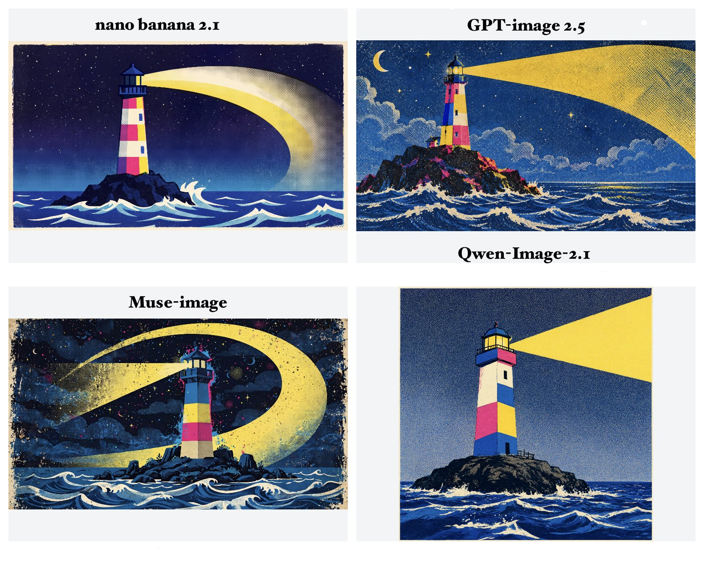

# Vintage Screen-Print Lighthouse at Night

**中文标题：** 复古丝网印刷风夜色灯塔  
**ID:** `gi25-x-717` · **Mode:** `generate`  
**Categories:** `general`  
**Tags:** `x-twitter`, `community`, `gpt-image-2.5`, `x-direct`, `en`



### Vintage Screen-Print Lighthouse at Night

```text
A spectacular vintage screen-print illustration of a tall colorful lighthouse standing alone on a dark rocky island in a vast nighttime ocean. The lighthouse has geometric blocks of cream, hot pink, yellow and cobalt blue, with a dark blue roof. Its powerful yellow beam sweeps across the sky in a huge curved arc. Deep blue ocean with stylized white waves fills the bottom of the image. Dense halftone dots cover every surface, with rough paper texture and imperfect ink registration. Limited retro CMYK palette, flat graphic shapes, 1970s children's storybook screen-print aesthetic, mysterious and magical atmosphere, no text, 16:9.
```

- **Recommended model:** `gpt-image-2.5-sunburst`
- **Settings:** _(defaults)_
- **Source:** [community](https://x.com/hakmgpt/status/2107535382183387282) — @hakmgpt
- **License note:** Original public X post; quoted with attribution — remix with attribution
- **Notes:** Collected directly from X; original post https://x.com/hakmgpt/status/2107535382183387282; post text names GPT Image 2.5; discovered via Bin0754/gpt-image-gallery index, prompt re-verified against the original X post; verified=True; multi-model comparison post — preview is the comparison image
- **Preview:** `previews/gi25-x-717.jpg`
