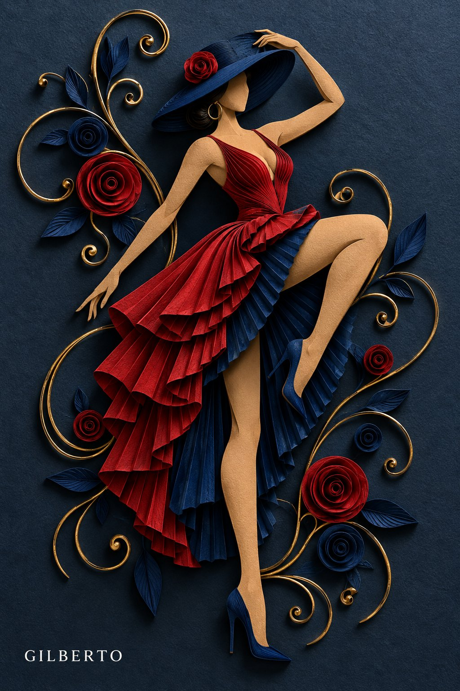

# Haute-Couture 3D Paper Quilling Bas-Relief

**中文标题：** 高定 3D 衍纸浅浮雕  
**ID:** `gi25-x-719` · **Mode:** `generate`  
**Categories:** `general`  
**Tags:** `x-twitter`, `community`, `gpt-image-2.5`, `x-direct`, `en`



### Haute-Couture 3D Paper Quilling Bas-Relief

```text
3D paper quilling bas-relief art of a faceless female [SUBJECT/POSE, e.g., dancer in a high-kick pose / fashion mannequin in a dynamic walking stride].

She wears a wide-brimmed [HAT COLOR] paper hat with a [ACCENT COLOR] paper rose, a [BODICE STYLE & COLOR, e.g., deep V-neck crimson red bodice], a flowing pleated [OVERSKIRT COLOR] overskirt, a fan-pleated [UNDERSKIRT COLOR] underskirt, and matching [SHOE COLOR] stiletto heels.

Surrounding her are swirling metallic [WIRE COLOR] wire tendrils, [LEAF COLOR] paper leaves, and coiled [FLOWER COLORS] paper roses. Set against a matte [BACKGROUND COLOR & TEXTURE, e.g., dark navy blue textured] backdrop with dramatic spotlighting casting soft paper drop shadows.  --ar 2:3
```

- **Recommended model:** `gpt-image-2.5-flare`
- **Settings:** _(defaults)_
- **Source:** [community](https://x.com/yourPlugAI/status/2108136293477536077) — @yourPlugAI
- **License note:** Original public X post; quoted with attribution — remix with attribution
- **Notes:** Collected directly from X; original post https://x.com/yourPlugAI/status/2108136293477536077; post text names GPT Image 2.5; discovered via Bin0754/gpt-image-gallery index, prompt re-verified against the original X post; verified=True; post names GPT Image 2.5 Flare; placeholders listed in the author's follow-up
- **Preview:** `previews/gi25-x-719.jpg`
