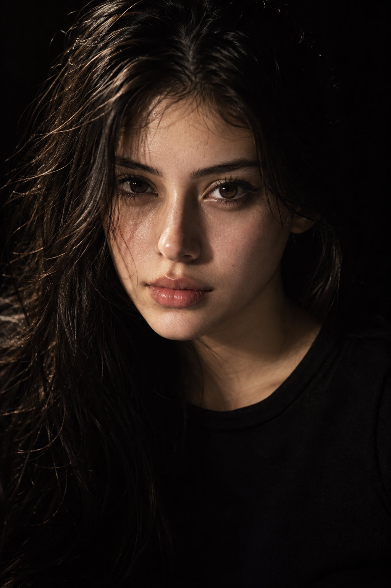

# Low-Key Studio Head-and-Shoulders Cinematic Portrait

**中文标题：** 低调光棚拍电影感头肩人像  
**ID:** `gi25-x-725` · **Mode:** `generate`  
**Categories:** `general`  
**Tags:** `x-twitter`, `community`, `gpt-image-2.5`, `x-direct`, `en`



### Low-Key Studio Head-and-Shoulders Cinematic Portrait

```text
Create an ultra-realistic, high-end cinematic portrait of a beautiful young woman, framed in a tight head-and-shoulders composition. She faces the camera directly with a calm yet intense expression and a confident, captivating gaze.

Use dramatic low-key studio lighting with a strong directional light illuminating one side of her face while the opposite side gradually disappears into deep, atmospheric shadow. Keep the background completely black and seamless, creating a striking contrast around her silhouette.

Her eyes are deep brown with subtle geometric catchlights. Give her naturally textured, slightly damp-looking hair with individual strands visible and realistic volume. She wears a simple, elegant black crew-neck top with no visible logos or patterns.

Capture extremely realistic skin with visible pores, fine facial texture, subtle imperfections, delicate peach fuzz, natural lips, and detailed eyelashes. Avoid overly smooth or plastic-looking skin.

Photographed with a cinematic 35mm lens aesthetic, shallow depth of field, soft optical falloff, realistic tonal range, subtle analog film grain, and premium editorial photography quality. The final image should feel like an authentic photograph captured in a professional studio — sophisticated, raw, atmospheric, and completely photorealistic, with no obvious AI-generated appearance.
```

- **Recommended model:** `gpt-image-2.5-sunburst`
- **Settings:** _(defaults)_
- **Source:** [community](https://x.com/john_my07/status/2107801411711123546) — @john_my07
- **License note:** Original public X post; quoted with attribution — remix with attribution
- **Notes:** Collected directly from X; original post https://x.com/john_my07/status/2107801411711123546; post text names GPT Image 2.5; discovered via Bin0754/gpt-image-gallery index, prompt re-verified against the original X post; verified=True; GPT Image 2.5 vs Nano Banana 2.1 comparison — preview is image 1 (GPT Image 2.5 per post order)
- **Preview:** `previews/gi25-x-725.jpg`
