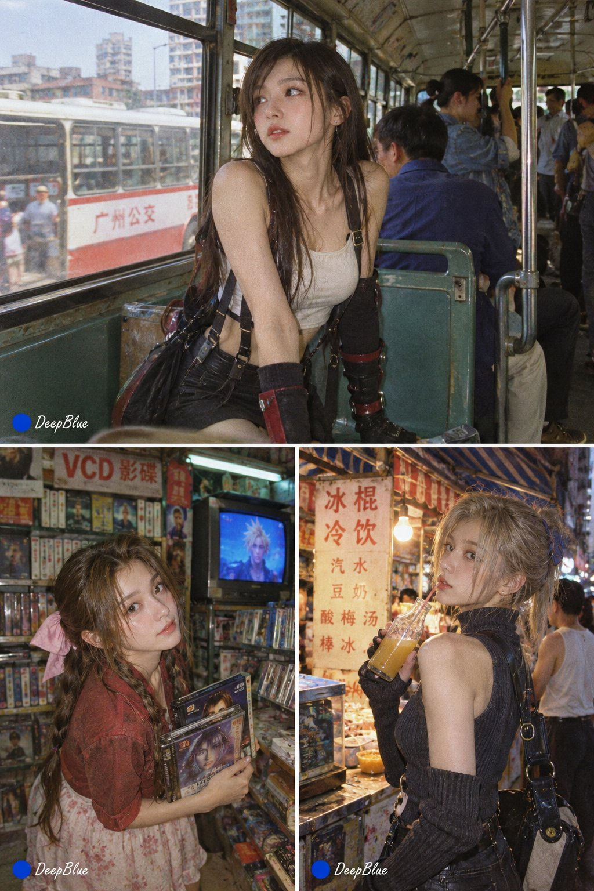

# 1990s China Color-Film Life Snapshots

**中文标题：** 90年代中国彩色胶片生活快照  
**ID:** `gi25-x-726` · **Mode:** `generate`  
**Categories:** `general`  
**Tags:** `x-twitter`, `community`, `gpt-image-2.5`, `x-direct`, `zh`



### 1990s China Color-Film Life Snapshots

```text
90年代中国生活影像 × 彩色胶片快照 ×
主题：【XXX】

随机元素：随机场景、随机人物、随机服装、随机动作与表情、随机实验镜头与构图。

视觉关键词：旧公交、录像厅、旧书店、街边摊、磁带、VCD、旧广告牌。

气质：真实、偶然、生活化、未经摆拍、怀旧。

主题角色的性格、身份与人物关系，自然转译为90年代中国城市生活中的人物状态。服装、行为、环境符合真实90年代生活逻辑。

每张独立随机抽取，互不继承；分别独立成像，不拼图、不宫格、不分屏。2:3竖幅。左下签名「🔵 DeepBlue」。

n=6
```

- **Recommended model:** `gpt-image-2.5-sunburst`
- **Settings:** _(defaults)_
- **Source:** [community](https://x.com/DeepBlueX0/status/2106075684577984560) — @DeepBlueX0
- **License note:** Original public X post; quoted with attribution — remix with attribution
- **Notes:** Collected directly from X; original post https://x.com/DeepBlueX0/status/2106075684577984560; post text names GPT Image 2.5; discovered via Bin0754/gpt-image-gallery index, prompt re-verified against the original X post; verified=True
- **Preview:** `previews/gi25-x-726.jpg`
