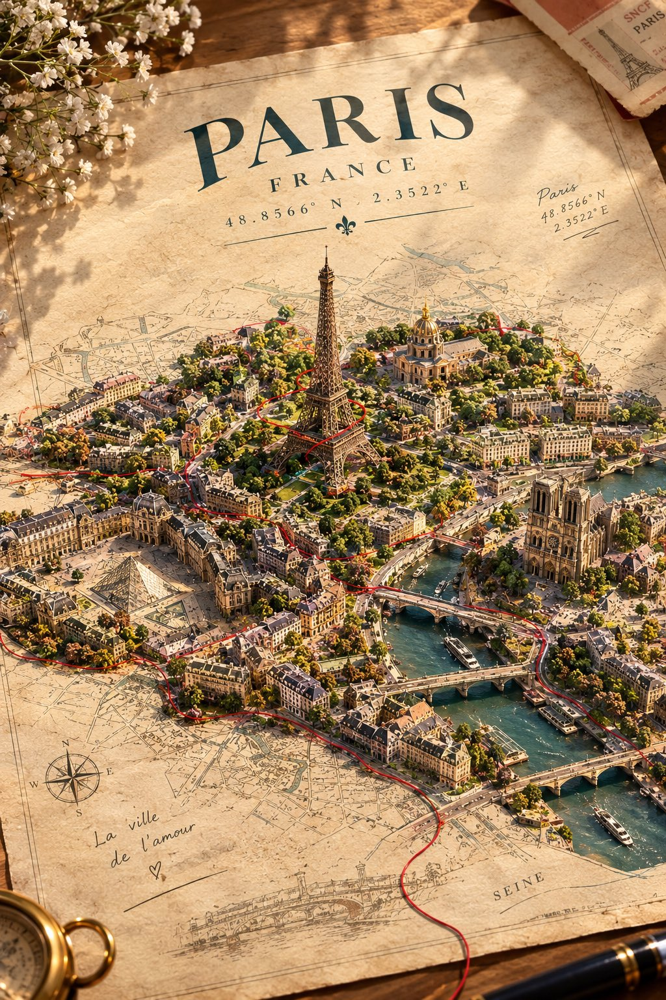

# City Breaking Free from an Old Paper Map

**中文标题：** 从旧纸地图中挣脱而出的城市  
**ID:** `gi25-x-730` · **Mode:** `generate`  
**Categories:** `general`  
**Tags:** `x-twitter`, `community`, `gpt-image-2.5`, `x-direct`, `en`



### City Breaking Free from an Old Paper Map

```text
A real city appears to be physically breaking free from an old paper map, with its actual streets, buildings, and famous landmark rising out of the printed geography into the real world.

Create a breathtaking, surreal-meets-realistic art composition of [CITY, COUNTRY], emerging from an enormous vintage paper map laid flat on a warm ivory surface.

The city’s REAL architecture and geography rise naturally from the map like a miniature three-dimensional world. Its famous landmark stands tall at the center, surrounded by accurately recognizable buildings, winding streets, bridges, rivers, and local architectural details. The printed roads on the map seamlessly transform into actual city streets, while tiny buildings gradually rise from flat ink illustrations into detailed miniature structures.

A single delicate red thread travels across the map, following the city’s real street layout before spiraling around its most famous landmark. Tiny handwritten location coordinates appear in the margin.

Use a stunning combination of architectural realism, miniature diorama photography, vintage cartography, subtle paper textures, and cinematic lighting. Warm sunlight creates long, beautiful shadows across the map. Keep the background minimal and elegant, with the city as the undeniable focal point.

At the top, display the city’s name in sophisticated vintage typography, with its country name and geographical coordinates beneath it.

The result should feel like a real city has magically escaped its map — imaginative, visually striking, geographically recognizable, and beautifully detailed.

Ultra-high detail, realistic materials, exceptional composition, premium art-poster aesthetic, no distorted buildings, no fictional architecture, no clutter.
```

- **Recommended model:** `gpt-image-2.5-sunburst`
- **Settings:** _(defaults)_
- **Source:** [community](https://x.com/Naiknelofar788/status/2109226850203619656) — @Naiknelofar788
- **License note:** Original public X post; quoted with attribution — remix with attribution
- **Notes:** Collected directly from X; original post https://x.com/Naiknelofar788/status/2109226850203619656; post text names GPT Image 2.5; discovered via Bin0754/gpt-image-gallery index, prompt re-verified against the original X post; verified=True
- **Preview:** `previews/gi25-x-730.jpg`
