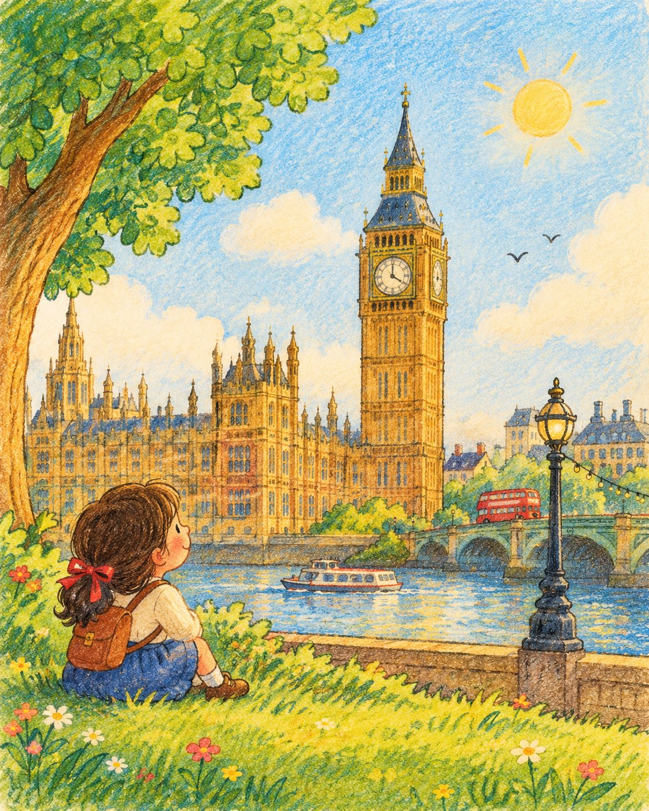

# Children's Storybook Landmark Illustration

**中文标题：** 儿童绘本风地标插画  
**ID:** `gi25-x-733` · **Mode:** `generate`  
**Categories:** `general`  
**Tags:** `x-twitter`, `community`, `gpt-image-2.5`, `x-direct`, `en`



### Children's Storybook Landmark Illustration

```text
Create a charming children’s storybook-style illustration of [LANDMARK], inspired by vintage activity-book artwork. Place the landmark in a bright, dreamy countryside or natural setting with soft hand-drawn black outlines, rounded illustrated elements, gentle watercolor textures, and cheerful pastel colors.

The landmark itself must be highly accurate and realistically depicted, closely matching its real-world architecture, proportions, shape, colors, windows, towers, rooftops, and distinctive details. Do not cartoonize, distort, simplify, or redesign the landmark. It should look like a faithful miniature representation of the actual landmark, while the surrounding environment remains whimsical and illustrated.

Add a cute little child exploring or looking toward the landmark. Include green rolling grass, a large leafy tree, tiny wildflowers, soft clouds, warm sunlight, and a simple blue sky. No sheep, lambs, or other oversized animals.

Keep the contrast intentional: realistic, instantly recognizable landmark + charming hand-drawn children’s-book surroundings. The child should have expressive innocent features and slightly exaggerated storybook proportions.

Visual style: vintage preschool activity book, soft hand-drawn outlines, watercolor + subtle crayon textures, slightly imperfect printed texture, nostalgic children’s illustration, cheerful and wholesome, detailed environmental elements, realistic landmark architecture, natural lighting, no photorealistic background.

Composition: portrait 4:5, full-page storybook illustration, landmark as the central visual element, child in the foreground, lots of colorful negative space, clean composition, no modern text, no sheep or lambs, no distorted architecture.
```

- **Recommended model:** `gpt-image-2.5-sunburst`
- **Settings:** _(defaults)_
- **Source:** [community](https://x.com/Naiknelofar788/status/2108165803338277063) — @Naiknelofar788
- **License note:** Original public X post; quoted with attribution — remix with attribution
- **Notes:** Collected directly from X; original post https://x.com/Naiknelofar788/status/2108165803338277063; post text names GPT Image 2.5; discovered via Bin0754/gpt-image-gallery index, prompt re-verified against the original X post; verified=True
- **Preview:** `previews/gi25-x-733.jpg`
