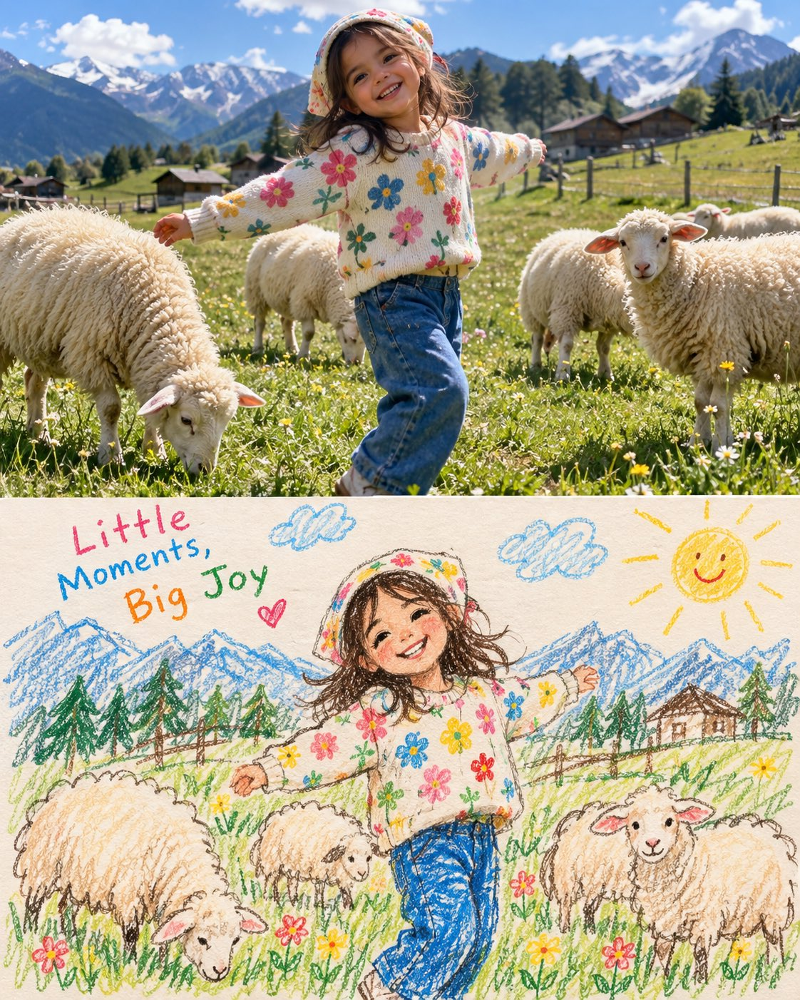

# Childhood Photo + Crayon Drawing Two-Panel Collage

**中文标题：** 童年照片＋蜡笔画双联拼贴  
**ID:** `gi25-x-734` · **Mode:** `generate`  
**Categories:** `general`  
**Tags:** `x-twitter`, `community`, `gpt-image-2.5`, `x-direct`, `en`



### Childhood Photo + Crayon Drawing Two-Panel Collage

```text
Create a charming, heartwarming two-panel vertical collage inspired by nostalgic childhood photography and handmade children’s crayon drawings.

TOP PANEL — PHOTOREALISTIC PHOTO: Capture a candid, ultra-realistic photograph of a happy young child enjoying a simple outdoor adventure in a beautiful countryside meadow. The child wears colorful, playful everyday clothing and a cute hat or headscarf, with a natural, spontaneous pose interacting with fluffy sheep grazing nearby. Alternatively, capture the child joyfully jumping in the air against a vivid blue sky. Use bright natural sunlight, authentic skin texture, realistic fabric details, soft shadows, natural colors, and an unposed documentary photography aesthetic. The scene should feel like a genuine childhood memory captured by a professional family photographer.

BOTTOM PANEL — MATCHING CRAYON DRAWING: Directly beneath the photograph, create a handmade children’s illustration of the exact same child, outfit, pose, and main subjects from the photograph. Use visible wax crayon strokes, colored-pencil scribbles, uneven hand-drawn outlines, imperfect proportions, and a warm ivory paper texture. Add small flowers, grass, clouds, a smiling sun, and playful decorative doodles. Include a few short handwritten words in colorful childlike lettering, such as “Little Moments, Big Joy” or “Jump for a Brighter Day.”

COMPOSITION: Stack both panels vertically with a clean horizontal division. The top photograph occupies approximately 60% of the image; the illustrated panel occupies the remaining 40%. Keep the child’s appearance, clothing colors, pose, and surroundings recognizable across both panels. Soft nostalgic colors, cheerful storytelling, wholesome family-album aesthetic, authentic handmade charm, high-quality photorealism in the upper panel, richly textured crayon artwork in the lower panel, portrait 4:5 composition.

IMPORTANT: The two panels must depict the same moment and subject. The upper half must look like a real photograph, while the lower half must look genuinely hand-drawn by a child. Do not blend the illustration into the photograph. Avoid 3D cartoon rendering, digital vector art, overly polished illustrations, artificial skin, and excessive decorative elements.
```

- **Recommended model:** `gpt-image-2.5-sunburst`
- **Settings:** _(defaults)_
- **Source:** [community](https://x.com/j_smeaton99/status/2109302750517588450) — @j_smeaton99
- **License note:** Original public X post; quoted with attribution — remix with attribution
- **Notes:** Collected directly from X; original post https://x.com/j_smeaton99/status/2109302750517588450; post text names GPT Image 2.5; discovered via Bin0754/gpt-image-gallery index, prompt re-verified against the original X post; verified=True
- **Preview:** `previews/gi25-x-734.jpg`
