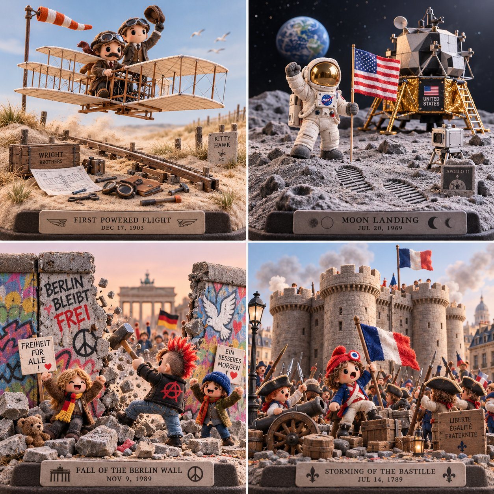

# 4 Days That Changed History — 2×2 Concept-Anchor Grid

**中文标题：** 改变历史的四天：2×2 概念锚点宫格  
**ID:** `gi25-x-736` · **Mode:** `generate`  
**Categories:** `general`  
**Tags:** `x-twitter`, `community`, `gpt-image-2.5`, `x-direct`, `en`



### 4 Days That Changed History — 2×2 Concept-Anchor Grid

```text
do this for 4 unforgettable days in human history , 2x2 grid: CONCEPT ANCHOR 1: "Stylized 3D animated rebel character — expressive oversized eyes, strong attitude pose, streetwear details, colorful hair, soft cinematic toy-like rendering"

::

CONCEPT ANCHOR 2: "Fuzzy green minimalist toy-world — mossy texture, rounded trees, soft felt surfaces, tiny houses, gentle surreal creatures, quiet gray background"

::

CONCEPT ANCHOR 3: "Isometric miniature scene — small props, tiny environmental storytelling, dollhouse-scale staging, clean studio lighting"

INSTRUCTION:
Find the exact visual center of these three concepts.
Ignore the literal character, trash can, animals, and room references.
Extract only the style and material logic.

Render $ SUBJECT as a soft but rebellious designer-toy diorama.

STYLE RULES:
- Convert the subject into a stylized 3D character, object, creature, or environment with clear attitude and expressive shape language.
- Use soft felt, moss, knitted fiber, fuzzy flocking, matte clay, and vinyl-like surfaces.
- Add small street or everyday details: stickers, scuffs, props, miniature objects, signs, containers, tools, or personal items inferred from the subject.
- Keep the world minimal and gallery-like, with calm gray or muted pastel background.
- Use bright accent colors only where they matter: hair-like forms, graffiti-like marks, symbols, accessories, tiny props.
- Blend softness with rebellion: cute surface texture, but confident pose and graphic edge.
- Use shallow studio lighting and clean product-shot presentation.

OUTPUT:
A collectible fuzzy designer-toy scene where $ SUBJECT becomes soft, expressive, slightly punk, and highly tactile.
```

- **Recommended model:** `gpt-image-2.5-sunburst`
- **Settings:** _(defaults)_
- **Source:** [community](https://x.com/Gdgtify/status/2107781229164556402) — @Gdgtify
- **License note:** Original public X post; quoted with attribution — remix with attribution
- **Notes:** Collected directly from X; original post https://x.com/Gdgtify/status/2107781229164556402; post text names GPT Image 2.5; discovered via Bin0754/gpt-image-gallery index, prompt re-verified against the original X post; verified=True; Nano Banana 2.1 vs GPT Image 2.5 comparison — preview is image 2 (GPT Image 2.5 per post order)
- **Preview:** `previews/gi25-x-736.jpg`
