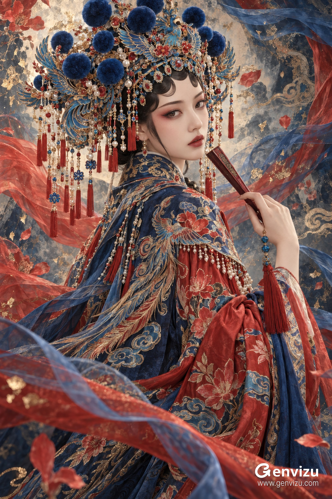

# Cantonese Opera Silk-and-Gold Art Portrait

**中文标题：** 粤剧丝绸金饰艺术人像  
**ID:** `gi25-x-739` · **Mode:** `generate`  
**Categories:** `general`  
**Tags:** `x-twitter`, `community`, `gpt-image-2.5`, `x-direct`, `en`



### Cantonese Opera Silk-and-Gold Art Portrait

```text
Create a single 2:3 vertical Chinese opera art portrait, combining the lifelike detail of refined fashion photography with the flowing environment of ornate Eastern digital painting.

The subject is an adult East Asian woman, approximately 25 years old, with an elongated oval face, a delicate chin, fair skin with natural warmth, slender almond-shaped dark eyes, gently arched eyebrows, and copper-red and crimson eyeshadow softly extending toward the temples. Fine black eyeliner, small deep-vermilion lips slightly parted. Her black hair is swept into a sleek updo, with three small curved opera-style locks along her forehead and one fine strand beside her cheek. Her expression is quiet, reserved, slightly melancholic, with direct eye contact. No exaggerated smile.

Frame her from the top of her elaborate crown to below the thighs. Her body faces away from the camera, angled slightly toward the left side of the image. Her shoulder and back form a diagonal rising from lower left to upper right. She turns her neck gracefully to the right, looking back at the viewer in a three-quarter view. Position her face approximately 53% across and 27% down the canvas. The large headdress spans roughly two-thirds of the image width and sits close to the upper edge.

Her nearer hand is raised on the right side, naturally holding a closed, slender folding fan with dark-red lacquered ribs. The fan angles toward the upper left, its tip suspended beside her jaw without touching her lips. Anatomically natural fingers and a relaxed wrist. Blue jade beads and a crimson tassel hang from the fan. Heavy robes fill the lower half, with sleeves and ribbons forming a long S-shaped flow toward the lower left. Use an intimate, eye-level composition with gentle telephoto-like perspective compression, avoiding wide-angle distortion.

Dress her in an elaborate Cantonese opera huadan–inspired stage costume: a standing-collar navy silk inner robe, vermilion outer sleeves, overlapping blue and red draped silk, and long, soft water sleeves. The neckline is modest and the body fully covered. Dense but clearly resolved gold-thread embroidery depicts dimensional phoenix feathers, kapok blossoms, small blue-green leaves, and curling cloud motifs. The embroidery follows the curved surfaces of the shoulders, back, and sleeves. Silk folds have believable weight and direction. Gold thread catches fine highlights while crimson and navy fabric remain dominant.

Give her a broad, intricate phoenix-style opera headdress layered with deep peacock blue, turquoise kingfisher-feather-like surfaces, gold filigree foliage, and vermilion gemstones. It fits closely around the forehead and expands into curved phoenix wings and delicate branches on both sides. Seven to nine cobalt-blue velvet pom-poms of varying sizes rise across the top. A small turquoise phoenix and red agate floral ornament sit near the center. Along the brow, turquoise ornaments edged in gold hold red teardrop stones. Fine gold chains, pearls, red and blue beads, and crimson silk tassels hang beside her face. Every component has a clear, plausible connection. Avoid melted metal and rigid mechanical symmetry.

The setting blends an abstract opera stage with a hand-painted mural, without realistic architecture. Deep navy, muted blue-gray, and warm gray-beige form the underlying palette. Behind her head, an irregular area of pale warm-gray paint and smoky washes separates the face and crown from the background.

Broad, translucent crimson ribbons enter from the middle left, curl behind her shoulders, and rise upward. Blue ribbons descend from the upper right, sweep along the right edge, and flow into the bottom of the image. Together they create a vortex around the figure. Combine translucent gauze, folded silk surfaces, and dry-brush marks. Add scattered kapok petals, tiny gold-leaf fragments, turquoise paint splashes, and sparse fine gold cloud lines. Build overlapping foreground, middle-ground, and background layers. Keep movement in the ribbons and painted shapes; the face, eyes, hand, and main headdress remain sharp.

A large, soft, warm light from the upper front left illuminates her forehead, cheek, nose, shoulder, and hand. Shadows carry cool-blue reflected light. Tiny warm-gold highlights catch the headdress edges and embroidery. Preserve subtle facial contours and soft neck shadows rather than flattening the face.

Use rich, layered color: approximately half navy, three-tenths vermilion, with turquoise, warm gold, and gray-beige completing the palette. The face is the calmest, brightest focal point. Slightly darken the edges. Soften the background while retaining painted texture. Resolve metal, velvet pom-poms, pearls, silk, and embroidery as distinct materials.

The atmosphere is dignified, dreamlike, sumptuous, and restrained, combining photographic dimensionality with the ornamental density of meticulous painting.

One complete image only. No borders, panels, text, signatures, logos, websites, or watermarks. No additional people. Do not simplify the crown into a small hairpin or turn the image into a generic costume portrait or anime face. Avoid plastic skin, excessive smoothing, malformed fingers, floating jewelry, and incoherent embroidery.
```

- **Recommended model:** `gpt-image-2.5-sunburst`
- **Settings:** _(defaults)_
- **Source:** [community](https://x.com/listudio/status/2108774582429843478) — @listudio
- **License note:** Original public X post; quoted with attribution — remix with attribution
- **Notes:** Collected directly from X; original post https://x.com/listudio/status/2108774582429843478; post text names GPT Image 2.5; discovered via Bin0754/gpt-image-gallery index, prompt re-verified against the original X post; verified=True
- **Preview:** `previews/gi25-x-739.jpg`
