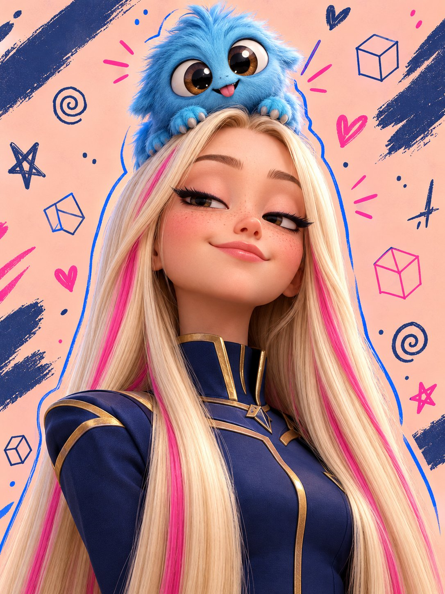

# 3D Stylized Sassy Blonde Character Portrait

**中文标题：** 3D 风格化金发少女角色肖像  
**ID:** `gi25-x-742` · **Mode:** `generate`  
**Categories:** `general`  
**Tags:** `x-twitter`, `community`, `gpt-image-2.5`, `x-direct`, `en`



### 3D Stylized Sassy Blonde Character Portrait

```text
A high-quality 3D stylized character portrait of a beautiful young blonde girl with extremely long, silky golden hair accented by subtle pink streaks, large expressive half-lidded blue-gray eyes, delicate freckles across her nose, long eyelashes, and a slightly unimpressed, sassy expression. She wears a sleek dark navy futuristic outfit with elegant metallic gold shoulder armor.

A tiny, adorable fluffy blue monster companion rests against her cheek and shoulder, with soft shaggy azure fur, darker blue patches, oversized googly eyes, and a cute curious expression. The girl glances sideways at the creature with an annoyed but secretly affectionate look.

Art style: premium Pixar-inspired 3D animation, stylized collectible character design, soft realistic fur simulation, detailed individual hair strands, smooth skin shading, cinematic subsurface scattering, glossy eyes, polished materials, exquisite lighting, and high-end animated movie quality.

Composition: vertical portrait, close-up to medium shot, character positioned centrally, head slightly tilted, long flowing hair framing the face and cascading down the body, blue creature prominently positioned in the foreground on the right side.

Background: soft pastel peach-pink gradient fading into warm ivory white, decorated with playful hand-drawn navy doodles, abstract geometric shapes, tiny stars, colorful hearts, curved sketch lines, and loose diagonal brushstrokes.

Lighting and colors: warm cinematic golden-hour lighting, gentle pink rim light, soft shadows, luminous blonde hair, vivid fluffy blue fur, deep navy clothing, metallic gold accents, pastel pink and lavender highlights.

Ultra-detailed 3D rendering, charming personality, expressive facial storytelling, soft depth of field, clean composition, vibrant yet harmonious colors, professional character concept art, sharp facial details, 4K quality, portrait aspect ratio 3:4. No text, no watermark.
2.Create a high-quality 3D animated character portrait of a cool, confident teenage girl with extremely long, straight platinum-blonde hair featuring subtle golden tones and vibrant hot-pink streaks. She has fair skin, a playful smirk, half-closed sleepy eyes, long black winged eyeliner, delicate freckles, and a relaxed, self-assured expression. She wears a fitted navy-blue futuristic school uniform with elegant gold trim, structured shoulders, and a high collar.

Perched on top of her head is a tiny, adorable fluffy blue monster with soft cyan fur, oversized glossy brown googly eyes, tiny paws, and a mischievous, lovable expression. The creature sits like a fluffy hat, adding a whimsical fantasy element.

Art style: premium Pixar-inspired 3D animation, stylized character design, ultra-detailed fur strands, realistic silky hair, smooth skin shading, cinematic studio lighting, subtle subsurface scattering, expressive facial features, polished materials, and professional character rendering.

Background: soft peach-pink pastel background with hand-drawn doodles, navy-blue abstract brush strokes, little hearts, geometric cubes, stars, spirals, and playful sketch marks. Add electric-blue contour lines around the characters and small neon-pink accents for a trendy, youthful aesthetic.

Composition: vertical 3:4 portrait, low-angle close-up, girl centered in the frame, head slightly tilted upward, confident attitude, fluffy blue creature fully visible above her head, long hair flowing down beyond the bottom edge, shoulders visible, dynamic framing, balanced negative space.

Lighting and colors: warm peach ambient lighting, soft highlights on blonde hair, cool blue reflections in the monster's fur, deep navy clothing, golden accents, vibrant pink details, gentle shadows, rich yet pastel color grading.

Ultra-sharp focus, exceptional detail, professional 3D character illustration, fashionable Gen-Z aesthetic, adorable fantasy companion, visually striking, polished animation-movie quality.
```

- **Recommended model:** `gpt-image-2.5-sunburst`
- **Settings:** _(defaults)_
- **Source:** [community](https://x.com/iamsofiaijaz/status/2108753476948054254) — @iamsofiaijaz
- **License note:** Original public X post; quoted with attribution — remix with attribution
- **Notes:** Collected directly from X; prompt posted as the author's reply https://x.com/iamsofiaijaz/status/2108753476948054254 to https://x.com/iamsofiaijaz/status/2108753280470020408, which carries the images and names GPT Image 2.5; discovered via Bin0754/gpt-image-gallery index, prompt re-verified against the original X post; verified=True
- **Preview:** `previews/gi25-x-742.jpg`
