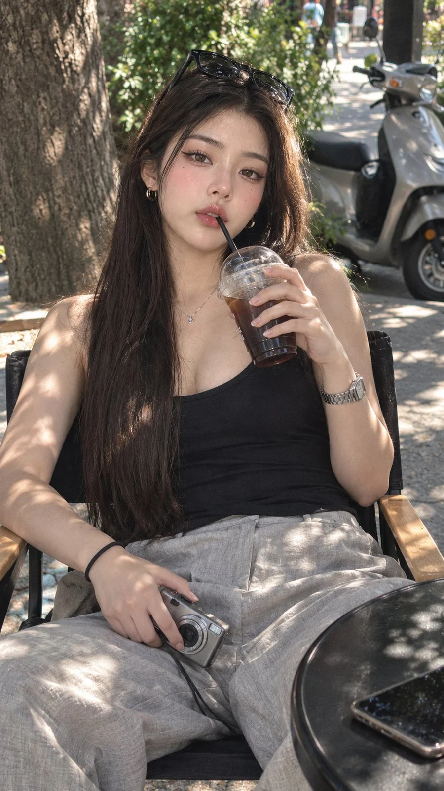

# Candid Iced-Coffee Lifestyle Photo in a Director's Chair

**中文标题：** 导演椅上喝冰咖啡的随拍生活照  
**ID:** `gi25-x-744` · **Mode:** `generate`  
**Categories:** `general`  
**Tags:** `x-twitter`, `community`, `gpt-image-2.5`, `x-direct`, `en`



### Candid Iced-Coffee Lifestyle Photo in a Director's Chair

```text
A very realistic candid lifestyle photo of a beautiful young woman with very long brown hair, shiny with the middle, sunglasses placed on top of her head. Soft natural makeup, dark brown eyes staring directly at the camera, lips lightly wrapped around a black straw, sipping black coffee ice from a clear plastic cup with a dome lid. He was wearing a black tank top with a fitted spoon neck and light gray wide-leg linen pants, a silver metal watch on his left wrist, a black hair tie on his right wrist, and held an antique silver compact digital camera in his right hand that was placed on his lap. He sat comfortably in a black folding director's chair with wooden armrests, leaning slightly back, legs open. Setting: outdoor street cafe under a big tree, speckled sunlight and the shadow of leaves falling on his face, body, and sidewalk. Background: silver-gray parked scooter, paved sidewalk, blurred greenery. Front ground: the edge of a black round table with a smartphone. Shot at eye level, 35mm lens, f/1.8, shallow depth of field, natural warm light with soft contrast, fine film grain, Kodak Portra color tone, sharp skin texture, 9:16 vertical composition.

Negative prompt:
Cartoon, illustration, plastic skin, extra finger, disabled hand, distorted face, blurry, too open, text, watermark, logo, extra limb
```

- **Recommended model:** `gpt-image-2.5-sunburst`
- **Settings:** _(defaults)_
- **Source:** [community](https://x.com/nawalsehar/status/2109514589427876256) — @nawalsehar
- **License note:** Original public X post; quoted with attribution — remix with attribution
- **Notes:** Collected directly from X; original post https://x.com/nawalsehar/status/2109514589427876256; post text names GPT Image 2.5; discovered via Bin0754/gpt-image-gallery index, prompt re-verified against the original X post via api.fxtwitter.com; verified=True
- **Preview:** `previews/gi25-x-744.webp`
