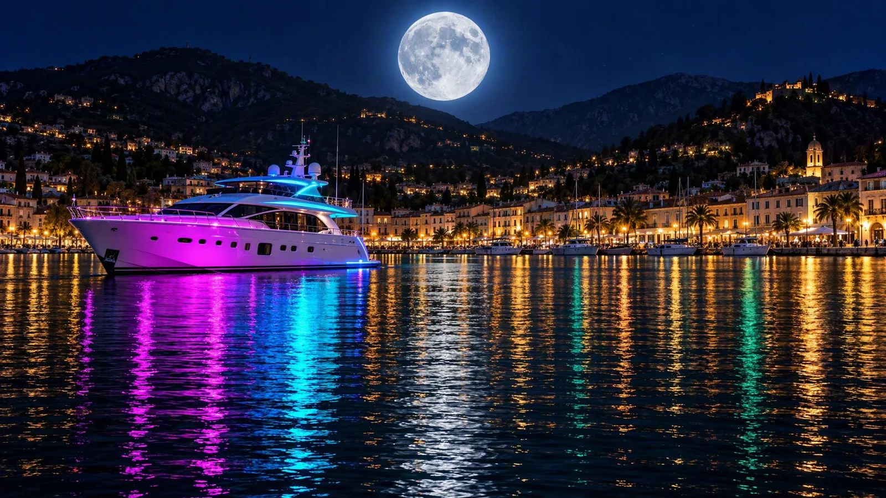

# Full Moon over a Neon Yacht Night Harbour

**中文标题：** 满月与霓虹游艇夜港  
**ID:** `gi25-x-747` · **Mode:** `generate`  
**Categories:** `general`  
**Tags:** `x-twitter`, `community`, `gpt-image-2.5`, `x-direct`, `en`



### Full Moon over a Neon Yacht Night Harbour

```text
Photorealistic night harbour scene, wide 16:9 panoramic composition, cinematic, ultra-detailed. Edge to edge, no frame, no border.

HARBOUR: the lower half is calm black water rippling in fine horizontal chop, carrying long smeared vertical reflections that stretch down the frame.

MOON: high in the upper middle of the deep navy night sky hangs one enormous, sharply detailed full moon, its craters crisp, ringed by a soft cool blue-white halo. The sky is darkest at the top corners, paling slightly toward the horizon.

BOAT: just left of centre sits a sleek modern white motor yacht at rest, seen broadside from the front-left. Its flanks are washed in vivid neon ultraviolet magenta along the hull and glowing electric cyan along the upper deck and railings, with a dark tinted glass bridge, a radar mast, a blue-lit stern platform and a line of small dark portholes.

HILLS: behind, layered dark ridgelines rise across the full width, their slopes dotted with scattered warm gold lights of hillside villas and small windows.

TOWN: along the water's edge runs a continuous waterfront promenade of low pale buildings with warm golden lit façades, arcades, windows and streetlamps. A row of moored white boats and small yachts lines the quay in dark silhouette.

REFLECTIONS: the water is split into ribbons of colour. Directly beneath the yacht run two bold vertical bands — bright magenta and electric cyan — vivid and saturated, broken into short ripples. Across the rest of the surface, the town lights throw long warm amber and orange columns, with cooler teal and deep green streaks threading between them in the lower right.

PALETTE: deep navy, near-black water, brilliant magenta, electric cyan, warm amber gold, teal green, silver-white moon. Sharp focus, high dynamic range, glossy wet highlights, clean and unmarked.
```

- **Recommended model:** `gpt-image-2.5-sunburst`
- **Settings:** _(defaults)_
- **Source:** [community](https://x.com/churvikv/status/2109710598972035578) — @churvikv
- **License note:** Original public X post; quoted with attribution — remix with attribution
- **Notes:** Collected directly from X; original post https://x.com/churvikv/status/2109710598972035578; post text names GPT Image 2.5; discovered via Bin0754/gpt-image-gallery index, prompt re-verified against the original X post via api.fxtwitter.com; verified=True; post names GPT Image 2.5 Sunburst (via gmi_cloud)
- **Preview:** `previews/gi25-x-747.webp`
