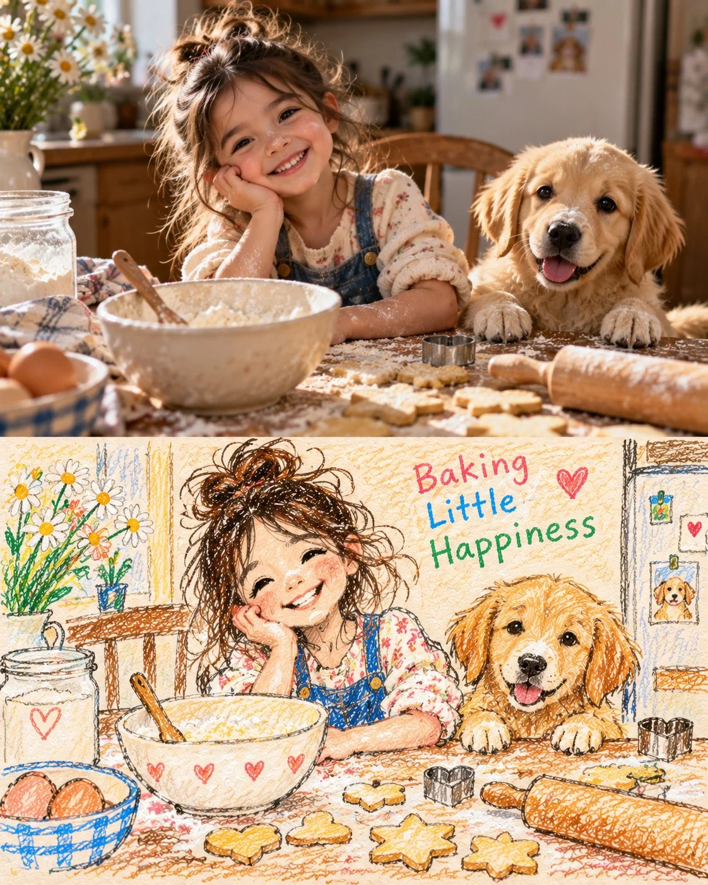

# Blanket-Fort Photo + Crayon Drawing Two-Panel Collage

**中文标题：** 毯子帐篷照片＋蜡笔画双联拼贴  
**ID:** `gi25-x-754` · **Mode:** `generate`  
**Categories:** `general`  
**Tags:** `x-twitter`, `community`, `gpt-image-2.5`, `x-direct`, `en`



### Blanket-Fort Photo + Crayon Drawing Two-Panel Collage

```text
Create a charming, heartwarming two-panel vertical collage inspired by nostalgic childhood photography and handmade children’s crayon drawings. Portrait 4:5 aspect ratio.

TOP PANEL — ULTRA-REALISTIC PHOTOGRAPH

Capture a cozy nighttime moment inside a magical homemade blanket fort. A happy young girl with naturally tousled brown hair, wearing cream-colored floral pajamas, lies comfortably on soft layered blankets, resting her cheek on one hand while smiling warmly at the camera. Beside her, a fluffy golden retriever puppy sleeps peacefully with its head resting on the blanket. A vintage glowing lantern sits on the left, casting a warm amber light across the scene. Tiny warm-white fairy lights decorate the draped cream blankets overhead. Include navy-blue star-patterned cushions, a cute brown teddy bear with a red bow, and a few children’s storybooks in the foreground. The background feels intimate, safe, and dreamy, like a treasured childhood memory captured at bedtime.

Use realistic skin texture, individual hair strands, natural facial expressions, authentic puppy fur, physically accurate fabric folds, soft shadows, shallow depth of field, subtle cinematic grain, warm tungsten lighting, and professional family-photography quality. The image must look like a genuine photograph, not AI-generated artwork.

BOTTOM PANEL — MATCHING HANDMADE CRAYON DRAWING

Directly beneath the photograph, recreate the exact same scene as a child’s handmade illustration. Depict the same girl with the same hairstyle, floral pajamas, smiling expression, resting pose, and the same sleeping golden puppy. Preserve the recognizable arrangement of the lantern on the left, glowing fairy lights, draped blanket fort, navy starry cushions, teddy bear, and storybooks.

Use visible wax-crayon strokes, colored-pencil scribbles, uneven hand-drawn outlines, imperfect childlike proportions, overlapping colors, and richly textured warm ivory drawing paper. Use dark blue, golden yellow, cream, orange, brown, and red crayons. Draw the fairy lights as glowing yellow dots, add hand-drawn stars and a crescent moon to the navy blanket, and include small hearts and playful doodles around the edges.

Write the words “Cozy Little Nights” in colorful, imperfect childlike handwritten lettering near the upper-right corner of the illustrated panel. Ensure the words are spelled correctly and remain clearly legible.

COMPOSITION AND QUALITY

Stack the two panels vertically with a clean, straight horizontal division. The top photograph occupies approximately 55–60% of the canvas, while the bottom illustration occupies the remaining 40–45%. Keep both panels visually aligned so the drawing feels like a child’s interpretation of the exact photograph above it.

The upper panel must remain completely photorealistic, while the lower panel must look genuinely handmade using crayons and colored pencils. Maintain a warm, nostalgic family-album atmosphere, gentle bedtime storytelling, and a consistent composition across both panels.

AVOID: 3D cartoon rendering, digital vector art, glossy illustrations, painterly photographic effects, artificial skin, distorted hands, extra fingers, duplicate puppies, inconsistent character appearances, mismatched poses, blended panel boundaries, excessive decorations, illegible text, watermarks, and logos.
```

- **Recommended model:** `gpt-image-2.5-sunburst`
- **Settings:** _(defaults)_
- **Source:** [community](https://x.com/j_smeaton99/status/2109665211884179753) — @j_smeaton99
- **License note:** Original public X post; quoted with attribution — remix with attribution
- **Notes:** Collected directly from X; original post https://x.com/j_smeaton99/status/2109665211884179753; post text names GPT Image 2.5; discovered via Bin0754/gpt-image-gallery index, prompt re-verified against the original X post via api.fxtwitter.com; verified=True
- **Preview:** `previews/gi25-x-754.webp`
