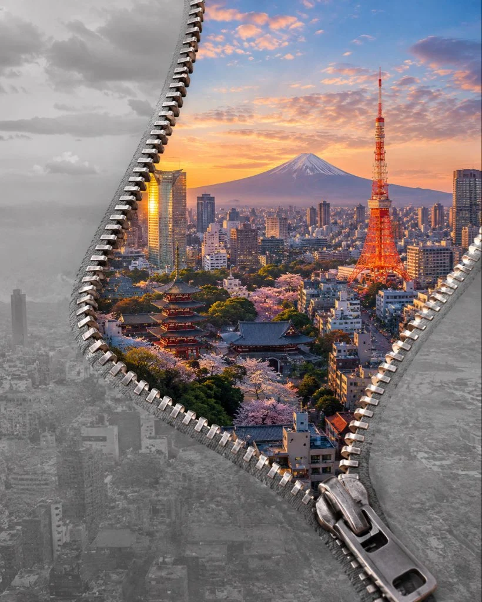

# Giant Zipper Unzipping Reality to Reveal a Destination

**中文标题：** 巨型拉链拉开现实露出目的地  
**ID:** `gi25-x-761` · **Mode:** `generate`  
**Categories:** `general`  
**Tags:** `x-twitter`, `community`, `gpt-image-2.5`, `x-direct`, `en`



### Giant Zipper Unzipping Reality to Reveal a Destination

```text
Create a breathtaking, photorealistic surrealist photograph of a giant metallic zipper partially opening the surface of an ordinary real-world environment, revealing an actual place from [COUNTRY / CITY / LANDMARK] behind it

A giant, physically realistic silver zipper runs diagonally across the scene. Its metallic teeth separate two edges of the outer surface, creating a large, natural-looking opening. The zipper must look like a real physical object, with brushed metal texture, fine scratches, accurate reflections, and realistic shadows.

INSIDE THE OPENING:
Reveal a breathtaking, photorealistic view of [COUNTRY / CITY / LANDMARK] as it actually exists in the real world.

If the subject is a country, show an authentic landscape featuring its real geographical features, traditional architecture, recognizable landmarks, and genuine cultural details.

If the subject is a city, show its actual streets, real buildings, recognizable skyline, authentic transportation, and characteristic urban atmosphere.

If the subject is a landmark, reproduce its real architecture with accurate proportions, materials, colors, windows, structural details, and surrounding environment.

Every building, street, vehicle, and architectural feature must look believable and consistent with the real location. Use actual-world architectural references rather than inventing structures.

THE VISUAL MAGIC:
The only surreal element is the giant zipper opening reality. The location inside must look like an authentic photograph taken by a professional travel photographer.

The real landscape extends naturally behind the zipper opening, with realistic perspective, atmospheric depth, natural sunlight, and physically accurate shadows. The zipper edges cast believable shadows onto the revealed scene, making the illusion convincing.

PHOTOGRAPHIC STYLE:
Ultra-photorealistic travel photography, natural daylight, realistic atmospheric perspective, true-to-life colors, physically accurate textures, professional full-frame camera quality, sharp architectural details, natural contrast, realistic depth of field, and premium editorial photography.

COMPOSITION:
Vertical 4:5 composition. The giant zipper occupies the foreground and opens wide enough to reveal the location clearly. The real-world destination is the main subject, immediately recognizable and visually dominant. Clean composition with no unnecessary decorative elements.

STRICT REALISM RULES:

No fantasy architecture or imaginary buildings.
No cartoon, illustration, painting, or CGI-looking landscapes.
No exaggerated colors, artificial glowing lights, or magical particles.
No distorted buildings, melted structures, or impossible roads.
No invented landmarks or inaccurate architectural details.
No extra zippers or unrelated objects.
No text, labels, borders, or watermarks.

Final result: A visually extraordinary yet convincing photorealistic image in which a giant zipper reveals a real place hidden behind reality. The concept is surreal; the destination itself is completely realistic.
```

- **Recommended model:** `gpt-image-2.5-sunburst`
- **Settings:** _(defaults)_
- **Source:** [community](https://x.com/Naiknelofar788/status/2108558447663071286) — @Naiknelofar788
- **License note:** Original public X post; quoted with attribution — remix with attribution
- **Notes:** Collected directly from X; original post https://x.com/Naiknelofar788/status/2108558447663071286; post text names GPT Image 2.5; discovered via Bin0754/gpt-image-gallery index, prompt re-verified against the original X post via api.fxtwitter.com; verified=True
- **Preview:** `previews/gi25-x-761.webp`
