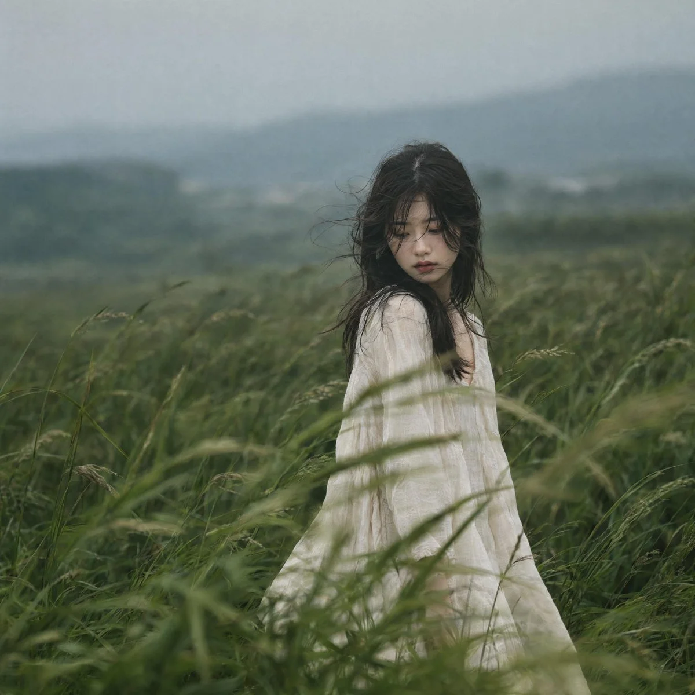

# Meadow Tall-Grass Cinematic Fashion Editorial

**中文标题：** 草甸高草间电影感时装人像  
**ID:** `gi25-x-768` · **Mode:** `generate`  
**Categories:** `general`  
**Tags:** `x-twitter`, `community`, `gpt-image-2.5`, `x-direct`, `en`



### Meadow Tall-Grass Cinematic Fashion Editorial

```text
A cinematic fashion-editorial portrait of a young East Asian woman standing partially concealed within tall, windswept green grass in an expansive meadow. She wears a loose, flowing off-white or ivory linen dress that moves softly with the breeze, contrasting gently against the rich natural surroundings.
Her dark hair appears naturally tousled by the wind, with soft strands falling across her face, partially veiling her eyes. Her head is gently lowered, gaze directed downward or slightly to the side, conveying a quiet, dreamy, introspective mood. The tall grass surrounds and partially obscures her figure, creating layered foreground elements, immersive depth, and a sense of visual intimacy.
Wind moves through the grass with subtle motion blur, while the subject remains sharply focused. The environment feels calm, isolated, and poetic, enhanced by a faint atmospheric haze and a muted palette of sage green, deep forest green, and soft neutral tones. Soft overcast daylight provides diffused, shadowless illumination with smooth tonal transitions, low contrast, gentle highlights, and realistic skin rendering.
Shallow depth of field produces creamy bokeh and natural background separation, while fine film grain adds an organic editorial texture. Minimalist composition emphasizing solitude and emotional storytelling. Square 1:1 composition, subject positioned slightly right of center with generous negative space above and around her, balanced visual weight, refined framing, sophisticated Korean and Japanese fashion magazine aesthetic, cinematic realism, highly detailed photorealistic photography, 85mm portrait lens, f/1.8, natural lens compression, ultra-realistic skin texture, premium color grading, atmospheric depth, elegant visual storytelling, award-winning editorial photography, masterfully composed, authentic and emotionally resonant.
```

- **Recommended model:** `gpt-image-2.5-sunburst`
- **Settings:** _(defaults)_
- **Source:** [community](https://x.com/MahnoorAi12/status/2101997369860493566) — @MahnoorAi12
- **License note:** Original public X post; quoted with attribution — remix with attribution
- **Notes:** Collected directly from X; prompt posted as the author's reply https://x.com/MahnoorAi12/status/2101997369860493566 to https://x.com/MahnoorAi12/status/2101997367641751808, which carries the images and names GPT Image 2.5; discovered via Bin0754/gpt-image-gallery index, prompt re-verified against the original X post via api.fxtwitter.com; verified=True; the author posted a separate girl/boy prompt pair; girl prompt quoted
- **Preview:** `previews/gi25-x-768.webp`
