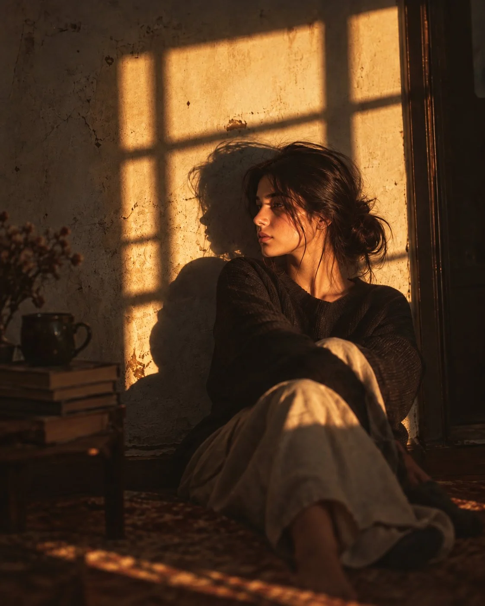

# Golden-Hour Window-Light Portrait in an Old Room

**中文标题：** 老屋窗光黄金时刻人像  
**ID:** `gi25-x-770` · **Mode:** `generate`  
**Categories:** `general`  
**Tags:** `x-twitter`, `community`, `gpt-image-2.5`, `x-direct`, `en`



### Golden-Hour Window-Light Portrait in an Old Room

```text
Create an ultra-realistic cinematic golden-hour portrait of a young woman sitting alone at a rustic wooden table inside an old, weathered room.

She has naturally beautiful features, warm medium skin, long dark slightly messy hair falling loosely around her shoulders, with soft strands framing her face. She wears an oversized black/dark charcoal knit sweater. Her pose is relaxed and introspective: one elbow rests on the table, her hand gently supports her cheek, and she gazes toward the side with a quiet, dreamy, slightly melancholic expression.

Warm late-afternoon sunlight streams through an unseen window, creating soft golden illumination and subtle rectangular window shadows across the aged, textured plaster wall behind her. The sunlight gently highlights her cheekbones, nose, lips, and loose strands of hair while the rest of the room remains deep and atmospheric.

The environment is an old vintage interior with cracked plaster walls, faded artwork and small photographs pinned casually to the wall, an aged wooden doorframe, worn wooden furniture, a stack of old books on the table, and a simple vintage ceramic coffee cup in the foreground.

Composition: intimate medium portrait, woman positioned slightly off-center, camera at eye level, natural candid photography, shallow depth of field, softly blurred background and foreground. Strong cinematic light and shadow, warm amber and brown color palette, subtle underexposure, realistic skin pores and texture, individual hair strands, natural facial imperfections.

Shot on a 35mm film camera, vintage analog photography, soft Kodak film grain, cinematic color grading, natural lens imperfections, gentle bloom, realistic volumetric sunlight, atmospheric shadows, high dynamic range, editorial photography, photorealistic, ultra-detailed, 8K quality, vertical 4:5 composition.

No text, no watermark, no logo, no artificial-looking skin, no excessive makeup, no CGI appearance.
```

- **Recommended model:** `gpt-image-2.5-sunburst`
- **Settings:** _(defaults)_
- **Source:** [community](https://x.com/Alina_with_Ai/status/2103456509745340476) — @Alina_with_Ai
- **License note:** Original public X post; quoted with attribution — remix with attribution
- **Notes:** Collected directly from X; prompt posted as the author's reply https://x.com/Alina_with_Ai/status/2103456509745340476 to https://x.com/Alina_with_Ai/status/2103456505643287033, which carries the images and names GPT Image 2.5; discovered via Bin0754/gpt-image-gallery index, prompt re-verified against the original X post via api.fxtwitter.com; verified=True; first of several prompts the author posted in the thread
- **Preview:** `previews/gi25-x-770.webp`
