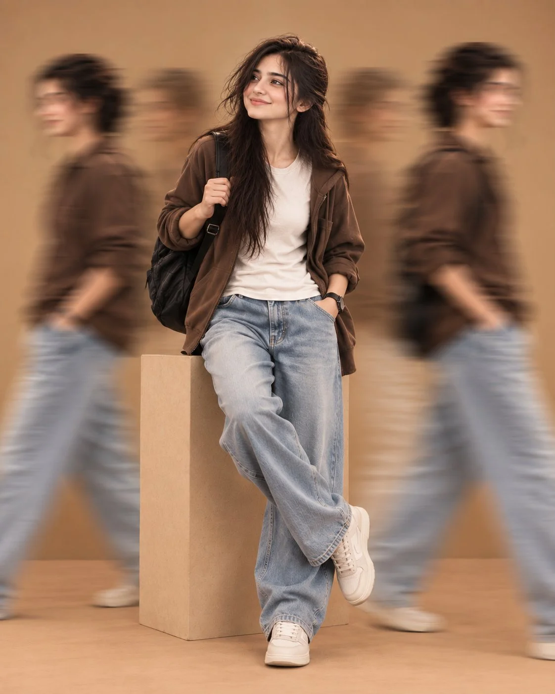

# Studio Full-Body Fashion Portrait with Motion Trails

**中文标题：** 影棚全身时装人像（动态残影）  
**ID:** `gi25-x-771` · **Mode:** `generate`  
**Categories:** `general`  
**Tags:** `x-twitter`, `community`, `gpt-image-2.5`, `x-direct`, `en`



### Studio Full-Body Fashion Portrait with Motion Trails

```text
Create an ultra-realistic full-body fashion portrait of a young woman standing casually in a minimalist studio environment. She has long, naturally tousled dark brown hair, soft expressive eyes, delicate facial features, and a gentle confident smile while looking slightly upward and to the side.

She is wearing a relaxed oversized brown utility jacket over a plain off-white T-shirt, loose-fitting light-wash blue jeans, and clean white low-top sneakers. A black backpack is worn over one shoulder, with one hand naturally holding the backpack strap and the other hand casually placed inside her jeans pocket. She is leaning casually against a tall rectangular beige concrete pedestal, with one leg crossed naturally over the other.

Around her, several blurred versions of the same woman are walking quickly from both sides, creating a strong long-exposure motion-blur effect. The central woman remains perfectly sharp and in focus while the surrounding moving figures are heavily motion blurred.

Warm beige monochromatic studio background, matching beige floor and pedestal, soft cinematic lighting, subtle shadows, natural skin texture, realistic fabric details, authentic denim texture, realistic hair strands, shallow depth of field, professional fashion photography, editorial street-style aesthetic, balanced composition, soft warm color grading, highly detailed, photorealistic, 8K resolution, HDR, realistic proportions, natural pose, cinematic depth, no text, no watermark.
```

- **Recommended model:** `gpt-image-2.5-sunburst`
- **Settings:** _(defaults)_
- **Source:** [community](https://x.com/mehwishkiran07/status/2101514985822151034) — @mehwishkiran07
- **License note:** Original public X post; quoted with attribution — remix with attribution
- **Notes:** Collected directly from X; prompt posted as the author's reply https://x.com/mehwishkiran07/status/2101514985822151034 to https://x.com/mehwishkiran07/status/2101514981841961338, which carries the images and names GPT Image 2.5; discovered via Bin0754/gpt-image-gallery index, prompt re-verified against the original X post via api.fxtwitter.com; verified=True; first of several prompts the author posted in the thread
- **Preview:** `previews/gi25-x-771.webp`
