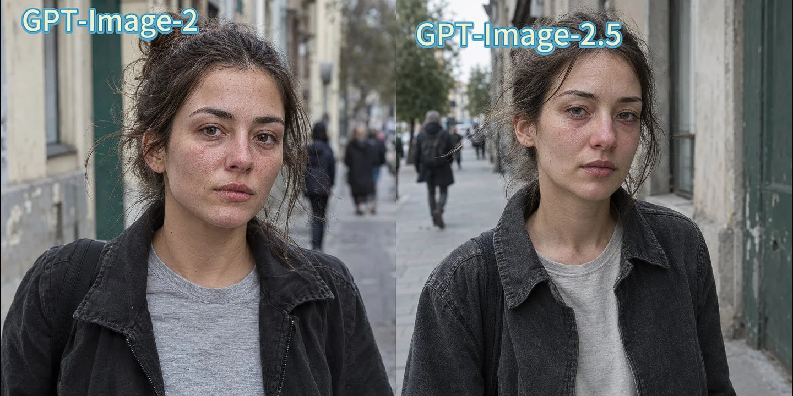

# Straight-out-of-Camera Documentary Street Portrait

**中文标题：** 直出质感纪实街头人像  
**ID:** `gi25-x-775` · **Mode:** `generate`  
**Categories:** `general`  
**Tags:** `x-twitter`, `community`, `gpt-image-2.5`, `x-direct`, `en`



### Straight-out-of-Camera Documentary Street Portrait

```text
gpt-image-2.5

prompt:

A straight-out-of-camera natural-light documentary street portrait photo of an adult young woman walking along an ordinary city street, framed from the waist up with a slightly off-center composition, her body moving naturally while her quiet, unposed gaze briefly meets the camera, wearing a simple faded charcoal jacket over a plain cotton shirt with visible weave, small wrinkles, lint, and natural fold shadows. Soft overcast daylight reveals visible pores across her cheeks, nose, forehead, and chin, fine vellus hair along the jaw and temples, mild redness around the nose and eyelids, natural under-eye texture, a few tiny blemishes, subtle T-zone shine, realistic muted lips with vertical lines and slight dryness, individual eyebrow hairs, a naturally uneven hairline, and loose flyaway strands shifting in a light breeze; preserve slight facial asymmetry and realistic eye moisture with small imperfect catchlights. Use believable portrait-lens compression and shallow but moderate depth of field, with the eye plane crisp and the ears, shoulders, passing pavement, worn building façades, and a few distant pedestrians gently falling out of focus, while retaining enough ordinary street context to make the location physically convincing. Include mild edge softness, faint grain in shadow areas, a slightly cool imperfect white balance, natural highlight rolloff, and soft real shadows beneath the nose, chin, collar, and hair strands. Keep the background subdued and free of readable signs or logos, with plausible muted greys, beige concrete, faded green, and natural skin tones. The emotional register is restrained, honest, slightly introspective, and physically present, with no airbrushing, no poreless or porcelain skin, no beauty retouching, no glamour pose, no fashion-campaign polish, no dramatic rim light, no neon, no CGI smoothness, no fake bokeh, no overprocessed HDR, no generic stock-photo look, no readable text, no logos, and no watermark.
```

- **Recommended model:** `gpt-image-2.5-sunburst`
- **Settings:** _(defaults)_
- **Source:** [community](https://x.com/SJinn_Agent/status/2097626219022090581) — @SJinn_Agent
- **License note:** Original public X post; quoted with attribution — remix with attribution
- **Notes:** Collected directly from X; prompt posted as the author's reply https://x.com/SJinn_Agent/status/2097626219022090581 to https://x.com/SJinn_Agent/status/2097626216081895806, which carries the images and names GPT Image 2.5; discovered via Bin0754/gpt-image-gallery index, prompt re-verified against the original X post via api.fxtwitter.com; verified=True; GPT-Image-2 vs GPT-Image-2.5 comparison post — preview is the post image
- **Preview:** `previews/gi25-x-775.webp`
