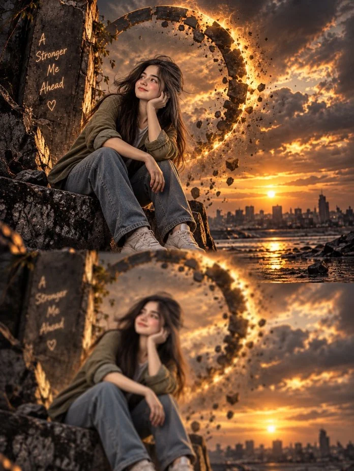

# Woman on Dark Rocks Beside a Glowing Portal

**中文标题：** 暗岩边发光传送门旁的女子  
**ID:** `gi25-x-785` · **Mode:** `generate`  
**Categories:** `general`, `character-consistency`  
**Tags:** `x-twitter`, `community`, `gpt-image-2.5`, `x-direct`, `en`



### Woman on Dark Rocks Beside a Glowing Portal

```text
Create a single unified ultra-realistic cinematic scene, NOT a split image, NOT a collage, and NOT two separate images.

A young woman is sitting calmly on a massive dark rocky structure beside the water during a dramatic golden sunset. She has long flowing dark brown hair, an olive-green oversized jacket, a simple light-colored shirt, wide-leg faded blue jeans, and white sneakers. She sits naturally with one hand resting against her cheek, looking slightly upward toward the sunset with a soft, peaceful and hopeful expression.

Behind her, create a huge broken circular portal made of dark ancient stone and glowing molten-golden energy. The circular ring is partially shattered, with realistic chunks of stone, dust, sparks, and debris floating around the broken sections. The glowing golden energy illuminates the woman from behind and creates beautiful cinematic rim lighting around her hair and body.

On the left side, a large cracked dark stone wall contains elegant handwritten glowing text:
“A Stronger Me Ahead”
with a small glowing heart underneath.

In the same single composition, the foreground continues naturally into shallow reflective water. The entire scene — the woman, rocky structure, broken glowing portal, sunset, clouds, and distant city skyline — creates a realistic reflection in the water below. The reflection should be visible directly beneath the main scene, slightly softer, dreamy, and naturally distorted by gentle water ripples, while remaining clearly recognizable.

The background features a distant modern city skyline beside the water, silhouetted against dramatic orange, golden, and dark-gray clouds. The sun is low on the horizon and creates a beautiful long golden reflection across the water.

IMPORTANT COMPOSITION:
Everything must exist inside ONE continuous physical environment and ONE cohesive image. The woman, broken golden portal, rocky structure, city, sunset, and their reflection must all connect naturally. The lower reflection must NOT look like a separate photograph, second image, collage, split screen, or duplicated scene. It must look like a real cinematic reflection in the water.

Make the main woman and environment extremely sharp and detailed, while the reflection below is naturally softer and slightly blurred because of the moving water. Maintain realistic perspective, lighting, reflections, and depth.

Ultra-photorealistic cinematic photography, realistic human anatomy, natural skin texture, detailed individual hair strands, realistic fabric folds, authentic facial proportions, physically accurate lighting, volumetric golden sunlight, atmospheric depth, realistic water reflections, subtle water ripples, floating dust and debris, dramatic clouds, HDR, cinematic depth of field, warm golden color grading, deep contrast, subtle film grain, highly detailed textures, 8K quality, masterpiece, realistic photography.

Avoid all unwanted elements: no split image, no collage, no two separate scenes, no stacked panels, no duplicated woman, no second woman, no duplicated portal, no multiple bodies, no distorted reflection, no deformed face, no distorted anatomy, no extra fingers, no extra hands, no extra limbs, no unnatural pose, no plastic skin, no artificial-looking face, no cartoon, no anime, no illustration, no low resolution, no flat lighting, no unrealistic water, no excessive blur on the main subject, no warped clothing, no malformed shoes, no incorrect perspective, no random objects, no misspelled text, no garbled letters.

The final result must look like a high-budget cinematic photograph captured at golden hour, with the woman and the broken glowing portal as the main visual focus and their natural reflection seamlessly integrated into the same scene.
```

- **Recommended model:** `gpt-image-2.5-sunburst`
- **Settings:** _(defaults)_
- **Source:** [community](https://x.com/mehwishkiran07/status/2101257730472419754) — @mehwishkiran07
- **License note:** Original public X post; quoted with attribution — remix with attribution
- **Notes:** Collected directly from X; prompt posted as the author's reply https://x.com/mehwishkiran07/status/2101257730472419754 to https://x.com/mehwishkiran07/status/2101257724579463584, which carries the images and names GPT Image 2.5; discovered via Bin0754/gpt-image-gallery index, prompt re-verified against the original X post via api.fxtwitter.com; verified=True; verified reply text (gallery had a longer concatenated variant)
- **Preview:** `previews/gi25-x-785.webp`
