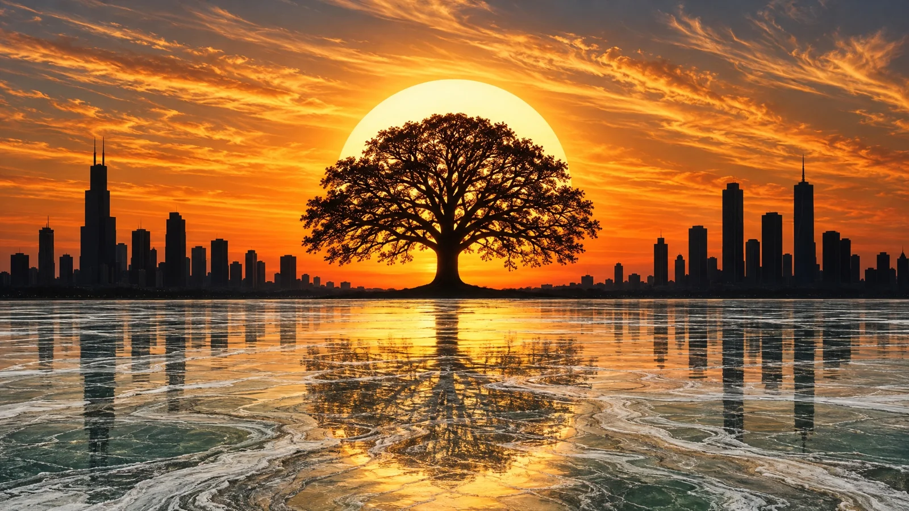

# Photorealistic Silhouette Sunset Composite Panorama

**中文标题：** 写实剪影日落合成全景  
**ID:** `gi25-x-794` · **Mode:** `generate`  
**Categories:** `general`  
**Tags:** `x-twitter`, `community`, `gpt-image-2.5`, `x-direct`, `en`



### Photorealistic Silhouette Sunset Composite Panorama

```text
Photorealistic silhouette sunset composite, wide 16:9 panoramic composition, cinematic, ultra-detailed. Edge to edge, no frame, no border.

SKY: the upper half is a furnace of amber, apricot and burnt gold, deepest at the horizon, cooling to smoky blue-grey at the very top. Long streaky cirrus clouds sweep diagonally across it, undersides lit gold, edges trailing thin warm wisps.

SUN: one huge perfectly round pale white-hot sun disc sits exactly at the centre of the frame just above the treeline, its rim glowing and bleeding a soft warm halo into the surrounding orange.

TREE: dead centre, in front of the sun, a single massive spreading broadleaf tree in pure black silhouette — a thick trunk flaring at the base into a rounded knoll, and a vast dense canopy of fine branch tracery and leaf clusters spreading wide and symmetrical, its edges softly dissolving into the glow.

CITY: flanking the tree, a dense skyline of black skyscraper silhouettes stands along a low ridge of rooftops. Left, a tall stepped tower with twin thin antennae, ringed by shorter blocks. Right, three dark high-rises of graduated height, one carrying a slender spire. The buildings never overlap the tree and never cross the sun.

WATER: the entire lower third is a frozen lake surface, not smooth water — a turbulent marbled expanse of glacial ice and flowed stone, banded in chalky white, sea-green, slate grey and warm tan in long swirling veins.

REFLECTION: sky, sun, tree and skyline all mirror downward into that marbled surface, broken and stretched by the ice grain. The reflected sun lies as a broad soft gold field beneath the trunk, the reflected tree spreads as a dark root-mass of branching veins below it, and the reflected towers hang as vertical dark bars, all smeared by the swirling white and green stone.

PALETTE: pure black, apricot, amber gold, burnt orange, smoky grey, chalk white, glacier green, tan. Sharp silhouette edges against soft glow, high dynamic range, clean and unmarked.

text, watermark, logo, signature, artist signature, handwritten signature, initials, monogram, date, stamp, seal, lettering of any kind, any words, digits, frame, border, picture frame, mat, bevel, molding, plaque, rectangular outline, painting, illustration, oil painting, impasto, watercolor, colored pencil, airbrush, digital art, cartoon, anime, chibi, flat 2d vector, blurry, soft focus, noisy grain, neon, fluorescent, oversaturated greens, blue midday sky, sunrise pink, purple sky, night, moon, stars, clouds covering the sun, rain, storm, lightning, snow falling, second tree, forest, multiple trees, leaves visible on tree with colour, lit windows on buildings, people, faces, birds, animals, deer, boat, ship, dock, bridge, road, cars, traffic, streetlamps, palm trees, mountains, desert, ocean waves, beach, sun cut off, tree cut off, off-centre tree, asymmetric composition
```

- **Recommended model:** `gpt-image-2.5-sunburst`
- **Settings:** _(defaults)_
- **Source:** [community](https://x.com/churvikv/status/2110114825082945740) — @churvikv
- **License note:** Original public X post; quoted with attribution — remix with attribution
- **Notes:** Collected directly from X; original post https://x.com/churvikv/status/2110114825082945740; post text names GPT Image 2.5; discovered via Bin0754/gpt-image-gallery index, prompt re-verified against the original X post via api.fxtwitter.com; verified=True; post names GPT Image 2.5 Sunburst
- **Preview:** `previews/gi25-x-794.webp`
