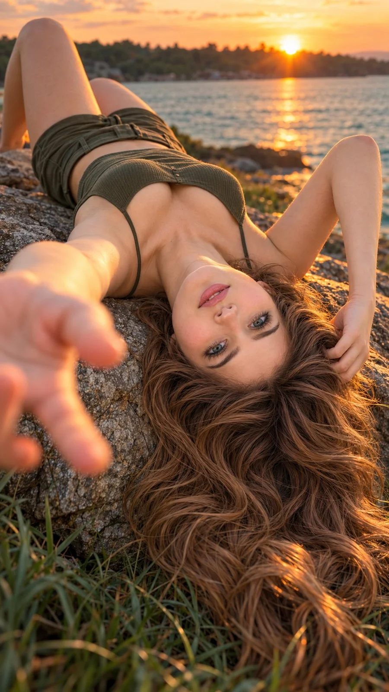

# Upside-Down Sunset Netflix-Style Cinematic Portrait

**中文标题：** 倒悬日落 Netflix 风电影人像  
**ID:** `gi25-x-795` · **Mode:** `edit`  
**Categories:** `general`, `character-consistency`  
**Tags:** `x-twitter`, `community`, `gpt-image-2.5`, `x-direct`, `en`



### Upside-Down Sunset Netflix-Style Cinematic Portrait

```text
Hyper-realistic IMAX-level Netflix-style cinematic upside-down sunset portrait, 9:16 vertical. Use the uploaded image as the primary visual reference and preserve the exact facial identity, proportions, and defining features. Create a woman wearing a dark olive-green sleeveless fitted top with thin straps and matching shorts. She is lying on her back diagonally across a large, uneven rock beside the water, with her upper body extending toward the distant shoreline and her head positioned closest to the camera, hanging backward over the near edge of the rock. Her face is naturally upside down from the viewer’s perspective, with her neck gently extended and her head tilted slightly to one side, maintaining a believable connection between her head, neck and shoulders. Her long hair spreads beneath her head, flowing over the rock and into the dark grass at the bottom of the frame. Her left arm reaches dramatically toward the lens, extending from the shoulder with the elbow slightly bent; her hand fills much of the left foreground, palm angled toward the camera, fingers loosely separated and naturally curved, appearing oversized through strong close-range perspective and noticeably blurred by shallow depth of field. Her right arm bends upward beside her head, with the elbow resting on the rock and her hand touching the hair near her forehead. Her brown eyes are wide and clearly focused directly on the camera despite her inverted position, with dark eyeliner, defined lashes and precisely shaped eyebrows. Her brows are gently raised, her eyelids open and alert, and her softly pursed pink lips create a subtle, playful, self-assured expression without a broad smile. Her long, thick chestnut-brown hair has a centre part, abundant loose S-shaped waves, distinct caramel-brown highlights and naturally separated strands, fanning outward around her head and cascading down the rock into the foreground. Her fair, luminous skin has realistic pores, subtle tonal variation and warm reflected sunset highlights. The setting includes rough grey-brown rock beneath her, dark teal grass framing the lower edges, calm blue-green water across the middle background and a softly blurred tree-lined shoreline at the horizon. The low sun peeks through the trees just behind her raised arm and head, creating a concentrated amber flare and a fine golden rim along the edges of her hair and shoulder. Use a low, close camera angle near the rock surface, with the face and reaching hand dominating the foreground and the shoreline remaining softly defocused. Apply a distinctive cinematic film look with warm peach, copper and amber highlights on the skin, rich chestnut hair, subdued turquoise water, deep desaturated teal-green shadows and earthy rock browns. Add gentle halation around the setting sun, subtle lens bloom, fine organic film grain, softly lifted shadow detail, restrained saturation and smooth highlight roll-off, while preserving natural skin colour and strong separation between the warm subject and cool surroundings. Keep the eyes and facial features crisp, the foreground hand softly blurred by realistic depth of field, and the distant background hazy with atmospheric sunset softness. 

Negative prompt: altered identity, twisted neck, misaligned head, distorted eyes, deformed fingers, extra limbs, bad anatomy, plastic skin, excessive sharpening, text, watermark.
```

- **Recommended model:** `gpt-image-2.5-sunburst`
- **Settings:** _(defaults)_
- **Source:** [community](https://x.com/imGopalTiwari/status/2110043764215644622) — @imGopalTiwari
- **License note:** Original public X post; quoted with attribution — remix with attribution
- **Notes:** Collected directly from X; original post https://x.com/imGopalTiwari/status/2110043764215644622; post text names GPT Image 2.5; discovered via Bin0754/gpt-image-gallery index, prompt re-verified against the original X post via api.fxtwitter.com; verified=True
- **Preview:** `previews/gi25-x-795.webp`
