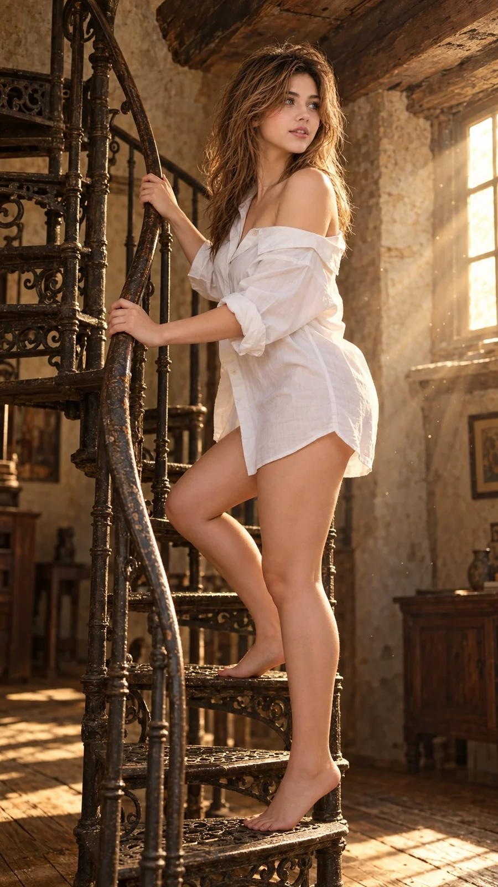

# Vintage Rustic Interior Netflix-Style Portrait

**中文标题：** 复古质朴室内 Netflix 风人像  
**ID:** `gi25-x-798` · **Mode:** `edit`  
**Categories:** `general`, `character-consistency`  
**Tags:** `x-twitter`, `community`, `gpt-image-2.5`, `x-direct`, `en`



### Vintage Rustic Interior Netflix-Style Portrait

```text
Hyper-realistic IMAX-level Netflix-style cinematic vintage rustic interior portrait, 9:16 vertical. Use the uploaded image as the primary visual reference and preserve the exact facial identity, proportions, and defining features. Create a woman wearing an oversized white button-up shirt with a classic collar, loose fabric, rolled-up sleeves and an off-the-shoulder neckline exposing one shoulder, with the shirt hem falling to her upper thighs. She stands barefoot on an old wrought-iron spiral staircase, her body turned sideways toward the right while her upper torso rotates slightly back toward the camera. One foot rests on a lower metal step while the other is placed on the step above, with her knees softly bent and her weight balanced naturally between the steps. Both arms extend toward the curved iron handrail: her right hand grips the upper curved section near chest height, while her left hand holds the lower section near her waist. Her shoulders remain relaxed, and her head turns toward the right, with her eyes gazing slightly upward into the distance, eyebrows gently lifted and lips softly parted in a thoughtful, composed expression. Her long dark-brown hair falls in loose, natural waves over her back and shoulders, with a subtle side part and a few strands framing her face. Fair luminous porcelain skin with a bright ivory to light beige tone and a neutral-cool undertone, realistic skin texture and warm highlights from the window. The setting is a rustic old stone interior with rough beige walls, exposed weathered wooden ceiling beams, aged wooden floorboards and a narrow spiral staircase made of dark, worn iron. A small rectangular window on the right floods the room with golden sunlight, illuminating floating dust particles and casting long, soft beams across the stone wall and staircase. Apply moody cinematic colour grading with warm amber highlights, earthy sepia and muted brown tones, deep shadowed corners, subtle olive undertones and controlled contrast. Preserve natural skin tones and realistic fabric textures, with gentle atmospheric haze and fine film grain for a timeless, cinematic photographic finish. Negative prompt: incorrect staircase pose, wrong hand placement, incorrect foot positioning, distorted hands or feet, bad anatomy, plastic skin, artificial lighting, oversaturation, text, watermark.
```

- **Recommended model:** `gpt-image-2.5-sunburst`
- **Settings:** _(defaults)_
- **Source:** [community](https://x.com/imGopalTiwari/status/2108868392899813387) — @imGopalTiwari
- **License note:** Original public X post; quoted with attribution — remix with attribution
- **Notes:** Collected directly from X; original post https://x.com/imGopalTiwari/status/2108868392899813387; post text names GPT Image 2.5; discovered via Bin0754/gpt-image-gallery index, prompt re-verified against the original X post via api.fxtwitter.com; verified=True
- **Preview:** `previews/gi25-x-798.webp`
