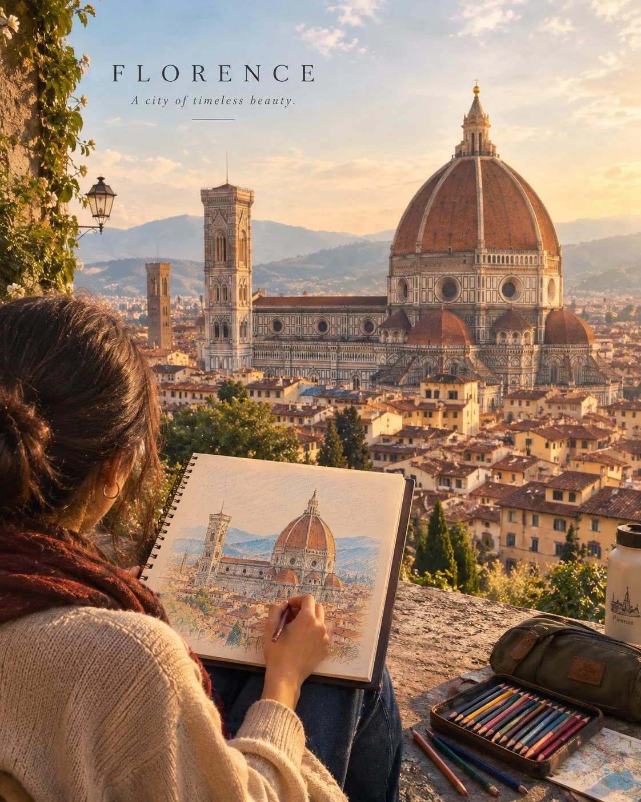

# Cinematic Travel Photo Sitting at a Landmark

**中文标题：** 地标旁坐下的电影感旅行照片  
**ID:** `gi25-x-803` · **Mode:** `generate`  
**Categories:** `general`  
**Tags:** `x-twitter`, `community`, `gpt-image-2.5`, `x-direct`, `en`



### Cinematic Travel Photo Sitting at a Landmark

```text
Create a beautiful, cinematic travel photograph of a person sitting comfortably on a small wooden stool in front of a world-famous landmark, creating a detailed hand-drawn artwork of the landmark on a large sketchbook.

The person is seen from behind or at a slight side angle, holding a pencil or colored pencil and carefully sketching the landmark while looking up at the real architecture for reference. An open sketchbook, scattered colored pencils, a few wax crayons, and a small art bag rest beside them.

The landmark is the main attraction: Show the actual landmark prominently in the background, with authentic architecture, accurate proportions, original colors, and recognizable details. The artwork on the person’s sketchbook should closely resemble the real landmark, creating a beautiful visual connection between the artist’s drawing and reality.

Art style: Realistic travel photography blended with a delicate colored-pencil and wax-crayon aesthetic. Visible pencil strokes, textured paper, soft hand-drawn shading, and subtle artistic imperfections.

Atmosphere: Warm golden-hour sunlight, gentle shadows, a peaceful breeze, and a dreamy yet believable travel atmosphere. Include small environmental details that reflect the landmark’s real location and culture.

Composition: Vertical 4:5 format, premium travel magazine cover, the seated artist in the foreground, the sketchbook clearly visible, and the magnificent landmark rising in the background.

Color palette: Warm beige, muted pastels, earthy tones, and naturally vibrant colors inspired by the destination.

The final image should feel artistic, emotional, peaceful, and visually captivating, like a beautiful memory captured while travelling.

Avoid distorted landmarks, fictional architecture, exaggerated fantasy elements, extra fingers, messy compositions, and artificial-looking textures. Keep the person, drawing materials, and landmark natural and realistic.
```

- **Recommended model:** `gpt-image-2.5-sunburst`
- **Settings:** _(defaults)_
- **Source:** [community](https://x.com/Naiknelofar788/status/2109981775661551659) — @Naiknelofar788
- **License note:** Original public X post; quoted with attribution — remix with attribution
- **Notes:** Collected directly from X; original post https://x.com/Naiknelofar788/status/2109981775661551659; post text names GPT Image 2.5; discovered via Bin0754/gpt-image-gallery index, prompt re-verified against the original X post via api.fxtwitter.com; verified=True
- **Preview:** `previews/gi25-x-803.webp`
