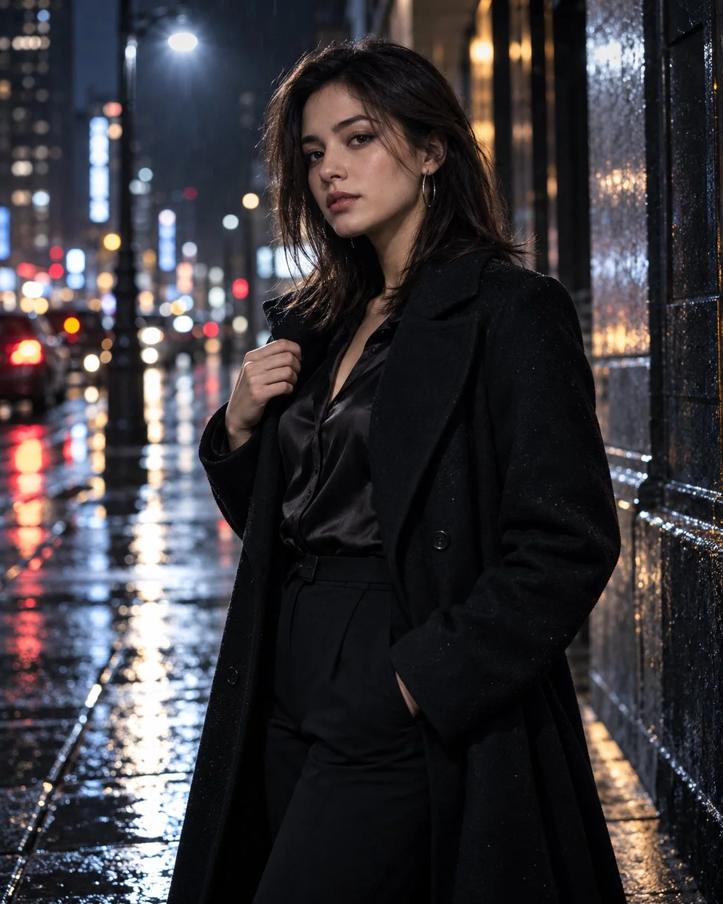

# Midnight Glass — Cinematic Glass Object Still Life (JSON)

**中文标题：** 午夜玻璃——电影感玻璃静物（JSON）  
**ID:** `gi25-x-805` · **Mode:** `generate`  
**Categories:** `general`  
**Tags:** `x-twitter`, `community`, `gpt-image-2.5`, `x-direct`, `en`



### Midnight Glass — Cinematic Glass Object Still Life (JSON)

```text
"type": "image_generation_prompt",
  "title": "Midnight Glass — Cinematic Night Portrait (Female)",
  "style": "cinematic film noir, contemporary fashion, cool-toned, high contrast",
  "concept": {
    "description": "A moody night portrait of a woman standing on a rain-slicked city sidewalk, lit by a single cool streetlight and distant neon reflections. The image emphasizes atmosphere, silhouette, and quiet confidence.",
    "mood": "mysterious, composed, cinematic",
    "color_palette": ["deep navy", "black", "silver", "cool white", "muted amber"]
  },
  "subject": {
    "gender": "female",
    "identity_preservation": {
      "use_reference_image": true,
      "alter_face": false,
      "notes": "Keep the woman’s facial features and physical appearance consistent with the reference image."
    },
    "pose": {
      "name": "Still Glance",
      "posture": "standing with one shoulder slightly turned toward the camera",
      "hand_action": "one hand lightly holding the edge of her coat collar",
      "expression": "calm, direct, restrained"
    },
    "appearance": {
      "hair": {
        "length": "shoulder-length",
        "texture": "straight with slight movement"
      },
      "makeup": {
        "style": "minimal, natural skin, defined eyes"
      }
    }
  },
  "wardrobe": {
    "coat": "long black tailored coat with a subtle sheen",
    "top": "dark silk blouse",
    "pants": "slim black trousers",
    "shoes": "black leather boots",
    "accessories": "thin silver hoop earrings"
  },
  "environment": {
    "background": {
      "setting": "wet urban street at night",
      "details": "soft bokeh lights, reflective pavement, distant blurred buildings",
      "style": "atmospheric, uncluttered"
    }
  },
  "lighting": {
    "type": "single cool key light from above and slightly to the side",
    "shadows": "soft but defined shadows",
    "effect": "creates depth and a quiet cinematic mood"
  },
  "camera": {
    "camera_model": "Sony A7R V",
    "lens": "50mm f/1.2",
    "aperture": "f/1.8",
    "iso": 400,
    "shutter_speed": "1/160s",
    "angle": "eye-level, slight three-quarter view",
    "framing": "vertical 4:5, head and torso with some environmental context",
    "resolution": "Ultra-HD"
  },
  "visual_effects": {
    "film_grain": "fine cinematic grain",
    "vignette": "gentle darkening at the edges",
    "texture_focus": ["coat fabric", "wet pavement reflections", "skin"]
  },
  "quality": {
    "realism": "photorealistic",
    "detail_level": "high editorial detail with natural skin texture"
  },
  "output_goal": "Create a realistic, cool-toned night portrait with a restrained film-noir atmosphere, strong composition, and convincing light and reflections."
}
```

- **Recommended model:** `gpt-image-2.5-sunburst`
- **Settings:** _(defaults)_
- **Source:** [community](https://x.com/MrDasCreates/status/2110029931828932952) — @MrDasCreates
- **License note:** Original public X post; quoted with attribution — remix with attribution
- **Notes:** Collected directly from X; original post https://x.com/MrDasCreates/status/2110029931828932952; post text names GPT Image 2.5; discovered via Bin0754/gpt-image-gallery index, prompt re-verified against the original X post via api.fxtwitter.com; verified=True; structured JSON prompt
- **Preview:** `previews/gi25-x-805.webp`
