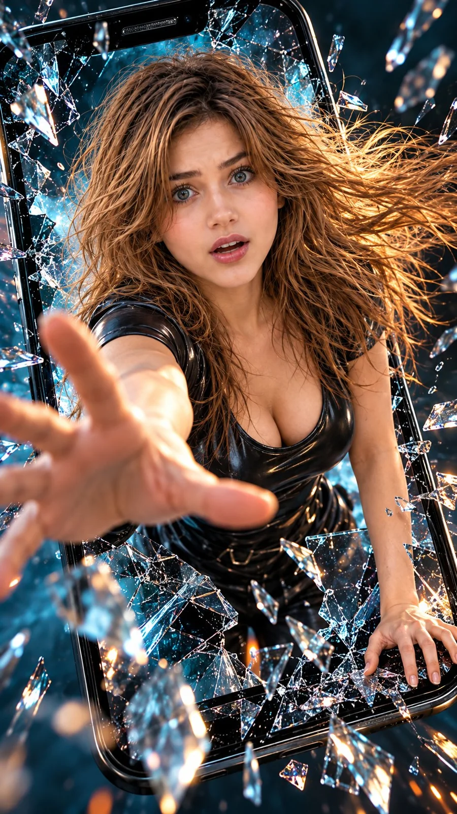

# Shattered-Screen Action Portrait (Netflix Style)

**中文标题：** 碎屏动作人像（Netflix 风）  
**ID:** `gi25-x-822` · **Mode:** `generate`  
**Categories:** `general`  
**Tags:** `x-twitter`, `community`, `gpt-image-2.5`, `x-direct`, `en`



### Shattered-Screen Action Portrait (Netflix Style)

```text
Hyper-realistic IMAX-level Netflix-style cinematic shattered-screen action portrait, 9:16 vertical. Use the uploaded image as the primary visual reference and preserve the exact facial identity, proportions, and defining features. Create a woman wearing a fitted black glossy leather top with short sleeves and a deep rounded neckline. Her torso leans forward at a three-quarter angle toward the camera, one arm thrust dramatically toward the lens with fingers spread wide, creating strong foreground perspective, while her other hand braces against the lower-right edge of the shattered smartphone screen. Her face shows intense surprise and shock, with eyes widened noticeably, upper eyelids raised, eyebrows lifted and slightly arched, lips parted in a startled expression, and subtle tension around her mouth as she looks directly into the camera. Her long, voluminous chestnut-brown hair with caramel highlights streams dynamically toward the right, with loose windswept strands framing her face and flying around her shoulders. Use natural warm beige skin tones with realistic texture and subtle highlights. Surround her with a giant black smartphone frame and suspended glass shards bursting outward, against a dark teal and cyan-lit background. Apply dramatic cinematic rim lighting, icy cyan reflections on the glass, warm amber highlights in her hair, deep inky shadows and bright specular glints. Use a rich teal-and-orange colour grade, high contrast, controlled skin tones, crisp glass details and shallow depth of field, keeping her shocked eyes sharp while the outstretched hand has natural perspective blur. 

Negative prompt: altered identity, weak expression, misaligned eyes, deformed hands, extra fingers, distorted face, unrealistic glass, text, watermark.
```

- **Recommended model:** `gpt-image-2.5-sunburst`
- **Settings:** _(defaults)_
- **Source:** [community](https://x.com/imGopalTiwari/status/2109890649973727309) — @imGopalTiwari
- **License note:** Original public X post; quoted with attribution — remix with attribution
- **Notes:** Collected directly from X; original post https://x.com/imGopalTiwari/status/2109890649973727309; post text names GPT Image 2.5; discovered via Bin0754/gpt-image-gallery index, prompt re-verified against the original X post via api.fxtwitter.com; verified=True
- **Preview:** `previews/gi25-x-822.webp`
