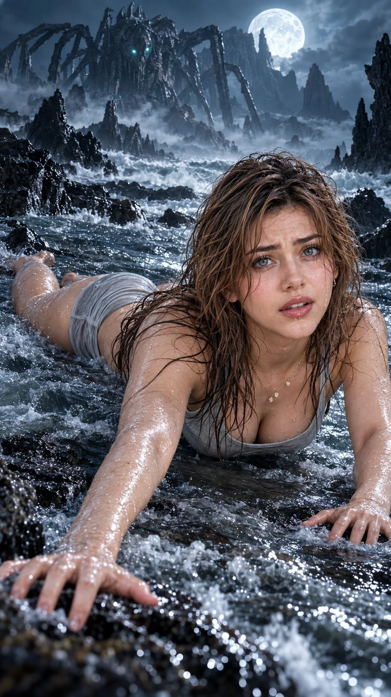

# Dark Fantasy Survival Portrait (Netflix Style)

**中文标题：** 黑暗奇幻求生人像（Netflix 风）  
**ID:** `gi25-x-823` · **Mode:** `generate`  
**Categories:** `general`  
**Tags:** `x-twitter`, `community`, `gpt-image-2.5`, `x-direct`, `en`



### Dark Fantasy Survival Portrait (Netflix Style)

```text
Hyper-realistic IMAX-level Netflix-style cinematic dark fantasy survival portrait, 9:16 vertical. Use the uploaded image as the primary visual reference and preserve the exact facial identity, proportions, and defining features. Create a woman wearing a soaked light-grey fitted tank top with thin straps and matching shorts, a delicate gold necklace with small pendants and subtle earrings. She lies prone in shallow, turbulent water, her chest slightly lifted on bent elbows, torso angled diagonally toward the right and hips and legs trailing behind her. Both arms stretch forward toward the camera, palms pressing against the wet rocky ground and fingers spread naturally; her shoulders are tense as she struggles forward through the water. Her face is lifted toward the camera, with wide grey-green eyes, slightly raised and drawn-together brows, and softly parted lips conveying fear, exhaustion and urgent alertness. Her long, dark chestnut-brown hair is completely wet, tangled into separated strands that cling across her forehead, cheeks, neck and shoulders, with loose sections trailing along the water. Use fair natural skin with realistic pores, damp highlights and tiny water droplets across her face, arms and shoulders. Behind her, create a vast moonlit alien shoreline with jagged black rocks, crashing silver waves, dense rolling fog and an enormous skeletal, spider-like creature looming through the distant mountains, its tiny cyan eyes glowing through the darkness beneath a bright full moon. Use cold moonlight from the upper right, icy blue rim lighting, silver reflections across the water and faint cyan illumination from the creature. Apply a desaturated steel-blue and charcoal colour grade with deep blacks, cool highlights, restrained saturation and subtle cinematic grain, contrasted by natural skin tones and sharp wet-surface reflections. Maintain realistic water physics, with ripples and foam surrounding her body and reflections following the moonlight. 
Negative prompt: altered identity, incorrect body alignment, floating limbs, distorted hands, extra fingers, dry hair, artificial water, excessive glow, text, watermark.
```

- **Recommended model:** `gpt-image-2.5-sunburst`
- **Settings:** _(defaults)_
- **Source:** [community](https://x.com/imGopalTiwari/status/2110030676481482994) — @imGopalTiwari
- **License note:** Original public X post; quoted with attribution — remix with attribution
- **Notes:** Collected directly from X; original post https://x.com/imGopalTiwari/status/2110030676481482994; post text names GPT Image 2.5; discovered via Bin0754/gpt-image-gallery index, prompt re-verified against the original X post via api.fxtwitter.com; verified=True
- **Preview:** `previews/gi25-x-823.webp`
