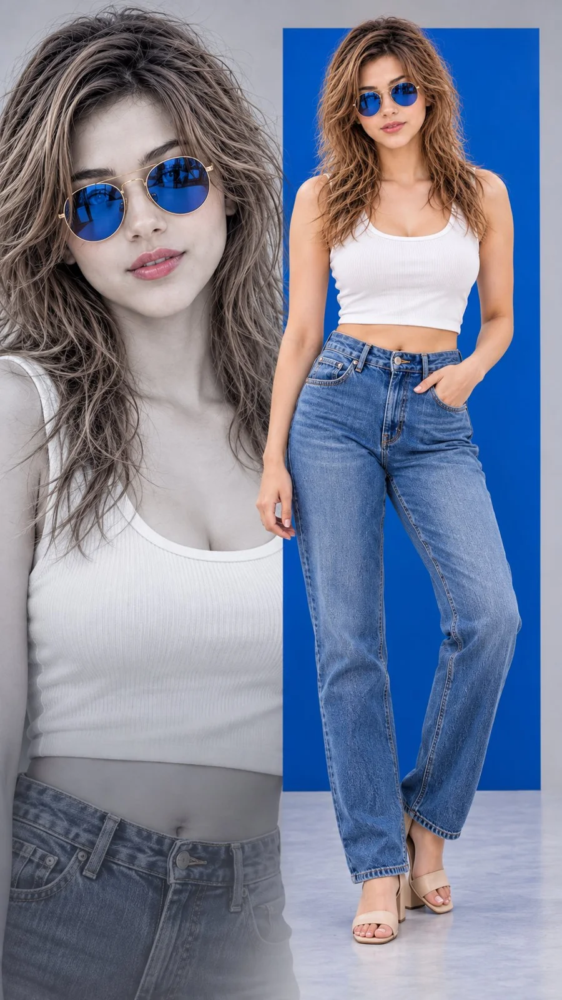

# Fashion Editorial Portrait (Netflix Style)

**中文标题：** 时装编辑人像（Netflix 风）  
**ID:** `gi25-x-824` · **Mode:** `generate`  
**Categories:** `general`  
**Tags:** `x-twitter`, `community`, `gpt-image-2.5`, `x-direct`, `en`



### Fashion Editorial Portrait (Netflix Style)

```text
Hyper-realistic IMAX-level Netflix-style cinematic fashion editorial portrait, 9:16 vertical. Use the uploaded image as the primary visual reference and preserve the exact facial identity, proportions, and defining features. Create a woman wearing a fitted white cropped tank top, high-waisted blue straight-leg jeans and beige open-toe block-heel sandals, accessorized with round blue mirrored sunglasses with thin gold frames. She stands with her torso facing mostly forward and her hips subtly shifted to one side, her left hand tucked into her front jeans pocket while her right arm hangs naturally beside her thigh; her legs are relaxed, with one knee slightly bent and one foot positioned forward. Her head faces the camera, chin level, with a composed, confident expression, relaxed brows, and softly closed lips behind the sunglasses. Her long honey-blonde hair has a center part, soft volume at the crown and loose flowing waves falling over both shoulders. Use natural fair skin with realistic texture and soft highlights. Create a clean modern studio composition with a large monochrome portrait of the woman wearing blue sunglasses on the left, a vivid cobalt-blue rectangular panel behind the full-body subject, and a pale cool-grey background. Apply balanced soft studio lighting, subtle shadows and a polished fashion-campaign colour grade featuring cobalt blue, cool grey, crisp white and natural denim tones, with controlled contrast and clean, sharp details. 
Negative prompt: altered identity, incorrect sunglasses, distorted hands, extra fingers, bad anatomy, unnatural pose, illegible text, watermark.
```

- **Recommended model:** `gpt-image-2.5-sunburst`
- **Settings:** _(defaults)_
- **Source:** [community](https://x.com/imGopalTiwari/status/2109910471717601369) — @imGopalTiwari
- **License note:** Original public X post; quoted with attribution — remix with attribution
- **Notes:** Collected directly from X; original post https://x.com/imGopalTiwari/status/2109910471717601369; post text names GPT Image 2.5; discovered via Bin0754/gpt-image-gallery index, prompt re-verified against the original X post via api.fxtwitter.com; verified=True
- **Preview:** `previews/gi25-x-824.webp`
