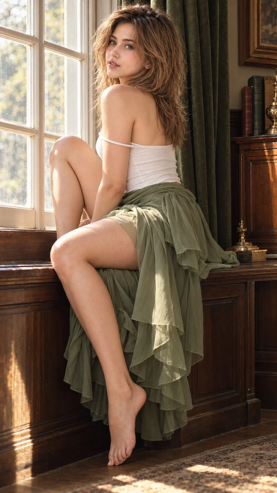

# Vintage Indoor Fashion Portrait (Netflix Style)

**中文标题：** 复古室内时装人像（Netflix 风）  
**ID:** `gi25-x-825` · **Mode:** `generate`  
**Categories:** `general`  
**Tags:** `x-twitter`, `community`, `gpt-image-2.5`, `x-direct`, `en`



### Vintage Indoor Fashion Portrait (Netflix Style)

```text
Hyper-realistic IMAX-level Netflix-style cinematic vintage indoor fashion portrait, 9:16 vertical. Use the uploaded image as the primary visual reference and preserve the exact facial identity, proportions, and defining features. Create a woman wearing a fitted white sleeveless camisole with thin spaghetti straps, one strap slipping naturally off her upper arm, paired with a layered, translucent sage-green chiffon skirt draped over her knees. She sits sideways on a dark wooden window ledge, her hips angled toward the right and her upper body gently twisted back toward the camera. One knee is raised high near her chest, bent sharply with the thigh angled upward beside the window, while her other leg hangs down in front of the wooden panel, the knee slightly bent and bare foot pointed toward the floor. Her hands rest loosely near her lap, partially hidden by the folds of the skirt. Her shoulders are slightly turned, with her head rotated back over her shoulder toward the camera. Her eyes look directly into the lens with a quiet, slightly inquisitive expression, softly raised inner brows and gently parted lips. Her voluminous chestnut-brown hair is styled in a tousled, layered blowout with feathered bangs swept diagonally across her forehead, loose face-framing strands and natural lift around the crown. Fair luminous porcelain skin with a bright ivory to light beige tone and a neutral-cool undertone, realistic skin texture and soft natural highlights. A large white-framed multi-pane window fills the left background, allowing daylight to illuminate the room; heavy dark olive-green curtains hang in deep folds on the right, above warm brown wooden wall panels and furniture. Soft window light falls across her face, shoulder and legs, while the curtain side remains in rich shadow. Apply cinematic vintage colour grading with muted sage green, warm honey-brown wood, creamy whites, gentle golden highlights and slightly faded shadows, balanced contrast and subtle film grain for a nostalgic editorial photograph. 
Negative prompt: incorrect seated pose, wrong leg placement, altered clothing, distorted hands or feet, bad anatomy, plastic skin, excessive sharpening, text, watermark.
```

- **Recommended model:** `gpt-image-2.5-sunburst`
- **Settings:** _(defaults)_
- **Source:** [community](https://x.com/imGopalTiwari/status/2108834530459271269) — @imGopalTiwari
- **License note:** Original public X post; quoted with attribution — remix with attribution
- **Notes:** Collected directly from X; original post https://x.com/imGopalTiwari/status/2108834530459271269; post text names GPT Image 2.5; discovered via Bin0754/gpt-image-gallery index, prompt re-verified against the original X post via api.fxtwitter.com; verified=True
- **Preview:** `previews/gi25-x-825.webp`
