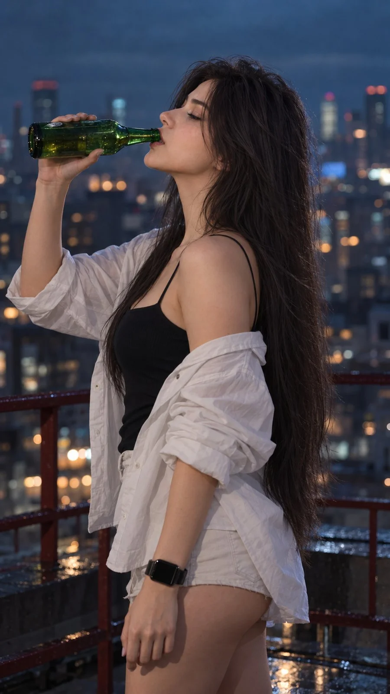

# Moody Rooftop Night Portrait (Netflix Style)

**中文标题：** 情绪屋顶夜景人像（Netflix 风）  
**ID:** `gi25-x-826` · **Mode:** `generate`  
**Categories:** `general`  
**Tags:** `x-twitter`, `community`, `gpt-image-2.5`, `x-direct`, `en`



### Moody Rooftop Night Portrait (Netflix Style)

```text
Hyper-realistic IMAX-level Netflix-style moody cinematic rooftop night portrait, 9:16 vertical. Use the uploaded image as the primary visual reference and preserve the exact facial identity, proportions, and defining features. Create a woman wearing a black spaghetti-strap top under an oversized white button-down shirt worn loosely off both shoulders, light-colored short bottoms and a black smartwatch on her wrist; she stands in a relaxed left-facing side profile, her torso turned slightly away from the camera, her head tilted gently upward and backward, chin raised, while her left arm is bent upward holding a green glass bottle at mouth level with the bottle neck clearly entering between her parted lips as she drinks, and her right arm hangs naturally downward beside her body with the hand relaxed; her eyes are mostly lowered and partially closed while drinking, eyebrows relaxed, lips naturally parted around the bottle opening, jaw slightly lifted and facial expression calm and casual; her very long dark-brown hair is straight, smooth and naturally heavy, falling from the crown all the way down her back past the waist with a few fine strands around her cheek and neck; fair luminous porcelain skin with a bright ivory to light beige tone and a neutral-cool undertone, realistic natural texture with very subtle highlights; she stands on an elevated outdoor terrace with a dark red metal railing, while a dense urban cityscape fills the background in heavy shallow focus with indistinct buildings, muted windows and scattered circular lights; soft overcast ambient light gives the scene a dim blue-gray atmosphere, with a faint cool glow outlining the hair and shoulders while the face and clothing remain gently underexposed, subtle warm bokeh lights appearing in the distant background and no harsh direct illumination; cinematic colour grading built around desaturated teal, blue-gray and charcoal tones with muted skin warmth, deep soft shadows, restrained highlights, low saturation, gentle contrast, atmospheric haze, creamy background bokeh and a subtle filmic grain, creating the same quiet rainy-evening city mood and understated cinematic depth. Negative prompt: changed identity, front-facing pose, bottle missing from mouth, bottle floating away from lips, closed mouth while drinking, incorrect hand position, bad anatomy, extra fingers, short hair, bright daylight, oversaturated colours, sharp background, text, watermark.
```

- **Recommended model:** `gpt-image-2.5-sunburst`
- **Settings:** _(defaults)_
- **Source:** [community](https://x.com/imGopalTiwari/status/2107463388292911316) — @imGopalTiwari
- **License note:** Original public X post; quoted with attribution — remix with attribution
- **Notes:** Collected directly from X; original post https://x.com/imGopalTiwari/status/2107463388292911316; post text names GPT Image 2.5; discovered via Bin0754/gpt-image-gallery index, prompt re-verified against the original X post via api.fxtwitter.com; verified=True
- **Preview:** `previews/gi25-x-826.webp`
