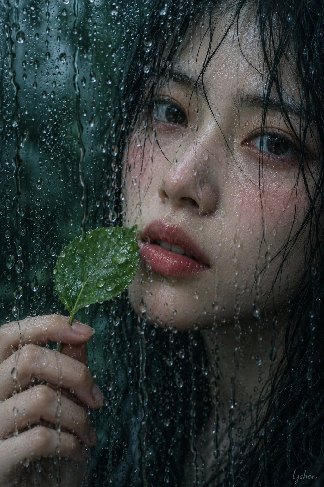

# Wet-Glass Close-Up Portrait with Leaf

**中文标题：** 隔着湿玻璃的面部特写（绿叶）  
**ID:** `gi25-x-827` · **Mode:** `generate`  
**Categories:** `general`  
**Tags:** `x-twitter`, `community`, `gpt-image-2.5`, `x-direct`, `zh`



### Wet-Glass Close-Up Portrait with Leaf

```text
2:3 竖幅隔着湿玻璃拍摄的面部特写。人物脸部占据画面中右部，头顶与右侧头发裁切，额头至下巴进入画幅；左下是一只手和一片鲜绿色叶子，左上保留暗绿背景。镜头与人物之间的玻璃布满大小不一的水滴和向下流淌的水痕。
一位年轻成年东亚女性，头向画面左侧轻转并略向左倾，鼻尖指向左侧，两只眼睛仍可见，视线朝镜头方向，双唇微微分开。一只手在左下方以放松弯曲的手指握住叶茎，将叶片举在唇边左侧。脸部轮廓柔和，鼻梁纤细，嘴唇自然饱满。湿黑发散贴额头与脸颊，细发掠过眼周和鼻侧；眼下与面颊有明显粉红晕染，嘴唇呈湿润玫瑰红。
背景为低细节深绿与青黑色块。前景水滴、人物面孔和手部形成重叠层次，部分水珠折射并遮挡五官。额头、鼻梁和近侧面颊柔亮，眼窝、脸缘与颈下更暗，整体曝光偏低。
采用明显冷青绿滤镜，暗部偏蓝绿、黑位深，叶片保留鲜绿，粉红眼周与玫瑰色嘴唇作为局部点缀。玻璃水痕造成局部折射、柔化与轻微朦胧，眼睛和鼻唇仍可辨；局部反差柔和，带微细颗粒状成像感。
```

- **Recommended model:** `gpt-image-2.5-sunburst`
- **Settings:** _(defaults)_
- **Source:** [community](https://x.com/lishishen7i/status/2110382348869214343) — @lishishen7i
- **License note:** Original public X post; quoted with attribution — remix with attribution
- **Notes:** Collected directly from X; original post https://x.com/lishishen7i/status/2110382348869214343; post text names GPT Image 2.5; discovered via Bin0754/gpt-image-gallery index, prompt re-verified against the original X post via api.fxtwitter.com; verified=True
- **Preview:** `previews/gi25-x-827.webp`
