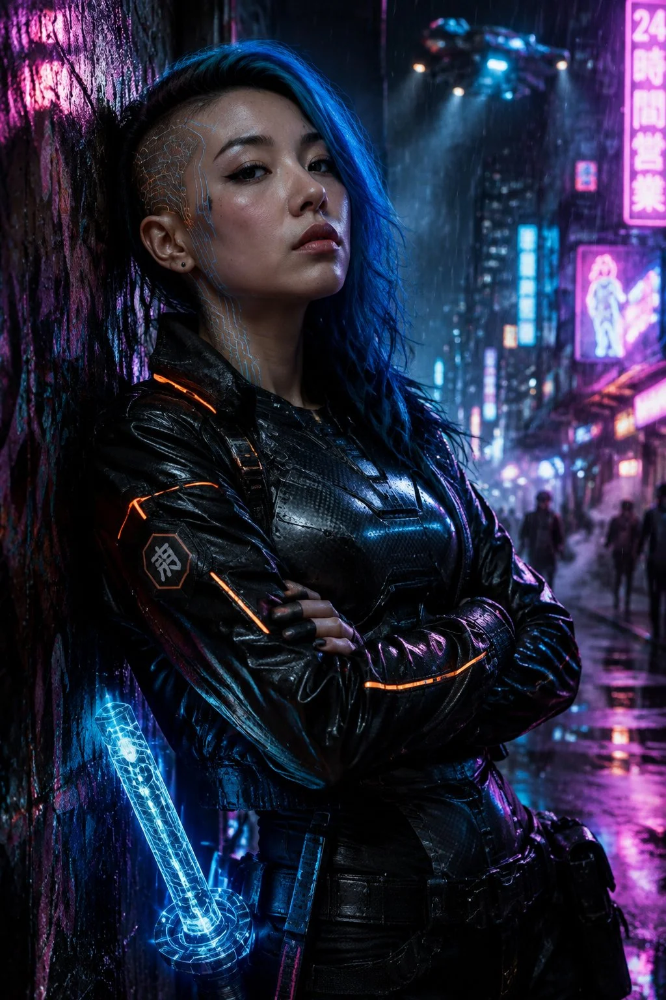

# Cyberpunk Neon Portrait of a Young Woman

**中文标题：** 赛博朋克霓虹年轻女性人像  
**ID:** `gi25-x-829` · **Mode:** `generate`  
**Categories:** `general`  
**Tags:** `x-twitter`, `community`, `gpt-image-2.5`, `x-direct`, `en`



### Cyberpunk Neon Portrait of a Young Woman

```text
cinematic ultra realistic portrait, cyberpunk aesthetic, 8k sharp details. A 25-year-old East Asian woman, a cybernetically augmented street mercenary, athletic build. Shaved-side haircut with long neon-blue dyed top swept back, faint glowing circuit tattoos tracing her temple and neck, natural skin with visible fine texture and pores, no plastic smoothing, subtle dark eye makeup. Defiant direct gaze into the camera, chin slightly raised. She wears a black techwear jacket with glowing orange seam lines, a carbon-fiber chest plate with scratches and wear marks, fingerless gloves. Leaning one shoulder against a rain-slicked neon wall, arms crossed, a holographic katana hilt clipped at her hip. Foreground: diagonal rain streaks catching neon light; midground: the figure; background: a neon-drenched alley with holographic billboards, steam rising from vents, a flying vehicle blurred overhead. Neon pink and cyan rim lighting from signage on both sides, 6500K key with deep shadows, wet reflections on the ground. Eye-level medium shot, 35mm lens, f/1.8, shallow depth of field, rule of thirds. Teal-magenta cyberpunk color grading, subtle film grain, Eastmancolor feel. Rebellious, electric, rain-soaked noir mood. Photorealistic style, sharp focus, high detail. No oil painting, no anime, no 3D render, no deformed hands, no extra fingers, no plastic skin, no oversaturated flat colors.
```

- **Recommended model:** `gpt-image-2.5-sunburst`
- **Settings:** _(defaults)_
- **Source:** [community](https://x.com/CandyTravelight/status/2109826460269597080) — @CandyTravelight
- **License note:** Original public X post; quoted with attribution — remix with attribution
- **Notes:** Collected directly from X; original post https://x.com/CandyTravelight/status/2109826460269597080; post text names GPT Image 2.5; discovered via Bin0754/gpt-image-gallery index, prompt re-verified against the original X post via api.fxtwitter.com; verified=True
- **Preview:** `previews/gi25-x-829.webp`
