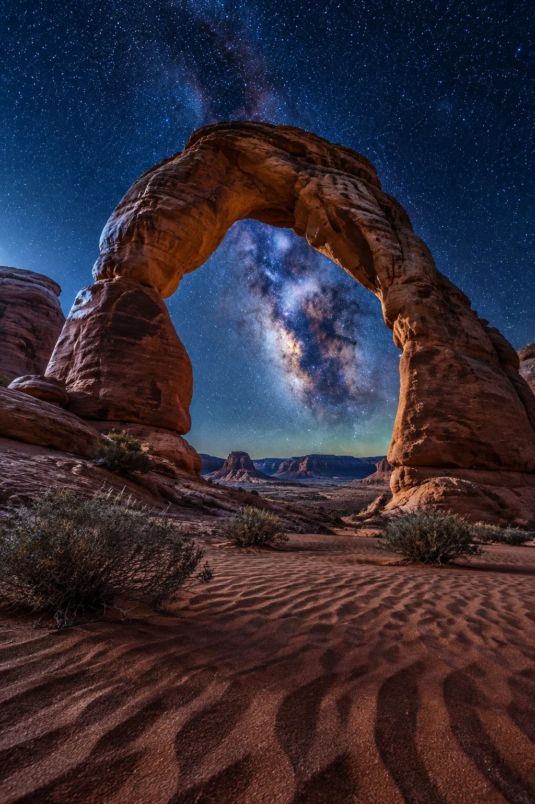

# Desert Rock Arch under the Milky Way

**中文标题：** 银河下的沙漠岩石拱门  
**ID:** `gi25-x-830` · **Mode:** `generate`  
**Categories:** `general`  
**Tags:** `x-twitter`, `community`, `gpt-image-2.5`, `x-direct`, `en`



### Desert Rock Arch under the Milky Way

```text
Photorealistic desert rock arch under the Milky Way at night, cinematic vertical landscape, 8k ultra detailed. A vast desert at midnight, air dry and perfectly clear. Subject details: a massive natural sandstone arch framing the night sky, wind-sculpted red rock formations around it, fine desert sand with ripple patterns in the foreground, a few drought-resistant shrubs. Atmosphere: absolute stillness, no wind, the desert asleep. Light: the Milky Way core blazing directly through the arch opening at 7500K cold blue night, dense starfield, faint airglow on the horizon, subtle moonlight from the left edging the rock. Depth layers: foreground rippled sand; midground the towering arch; background distant mesas; sky full of stars. Camera: 20mm ultra-wide, f/2.8, 25-second long exposure look, deep depth of field, tripod 1 meter above the sand. Color: deep blue night cinematic grade, warm amber rock tones under starlight, Eastmancolor film simulation, fine film grain. Composition: rule of thirds, arch centered framing the galactic core. Mood: silent, timeless, the desert asleep under the cosmos. Documentary nightscape photography style. Ultra-detailed, 8K quality. No people, no text, no watermark, no oil painting, no anime, no 3D render.
```

- **Recommended model:** `gpt-image-2.5-sunburst`
- **Settings:** _(defaults)_
- **Source:** [community](https://x.com/CandyTravelight/status/2110004296125436339) — @CandyTravelight
- **License note:** Original public X post; quoted with attribution — remix with attribution
- **Notes:** Collected directly from X; original post https://x.com/CandyTravelight/status/2110004296125436339; post text names GPT Image 2.5; discovered via Bin0754/gpt-image-gallery index, prompt re-verified against the original X post via api.fxtwitter.com; verified=True
- **Preview:** `previews/gi25-x-830.webp`
