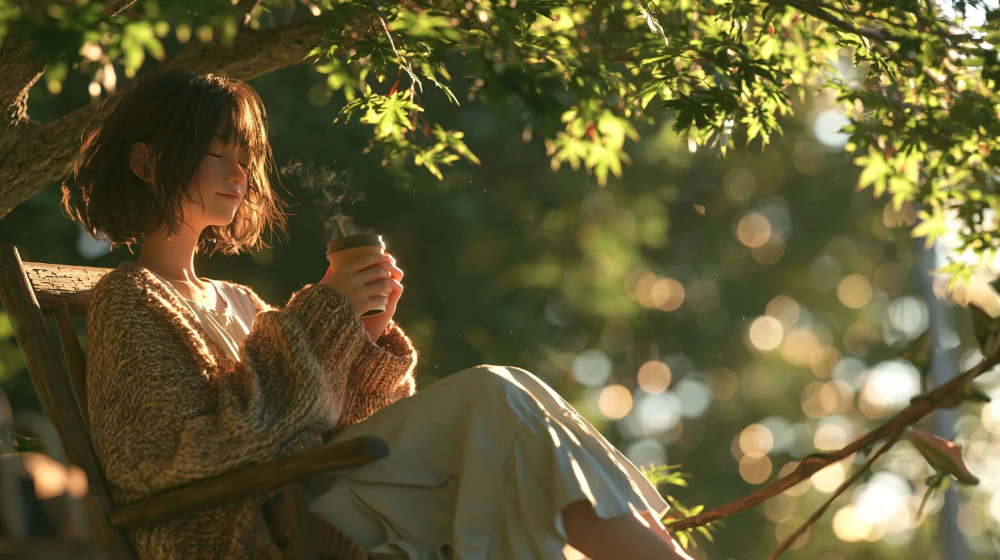

# Japanese 3D CG Animation Still Portrait

**中文标题：** 日系 3D CG 动画静帧人像  
**ID:** `gi25-x-834` · **Mode:** `generate`  
**Categories:** `general`  
**Tags:** `x-twitter`, `community`, `gpt-image-2.5`, `x-direct`, `en`



### Japanese 3D CG Animation Still Portrait

```text
cinematic Japanese 3D CG animation still, semi-realistic stylized CG young woman, youthful relaxed energy, effortlessly casual, bright global illumination, soft light, high dynamic range, luminous rim light, creamy Cooke lens rendering, large aperture, glowing bokeh, medium shot, sitting on a rustic wooden chair under a leafy tree, holding a warm coffee cup with both hands and sipping gently, oversized knit cardigan over a light dress, a steaming coffee cup, soft smile, gazing into the distance, early morning sunlight filtering through the leaves with dappled shadows and glowing background bokeh
```

- **Recommended model:** `gpt-image-2.5-sunburst`
- **Settings:** _(defaults)_
- **Source:** [community](https://x.com/Kurt_Rousey466/status/2110062637115736089) — @Kurt_Rousey466
- **License note:** Original public X post; quoted with attribution — remix with attribution
- **Notes:** Collected directly from X; original post https://x.com/Kurt_Rousey466/status/2110062637115736089; post text names GPT Image 2.5; discovered via Bin0754/gpt-image-gallery index, prompt re-verified against the original X post via api.fxtwitter.com; verified=True
- **Preview:** `previews/gi25-x-834.webp`
