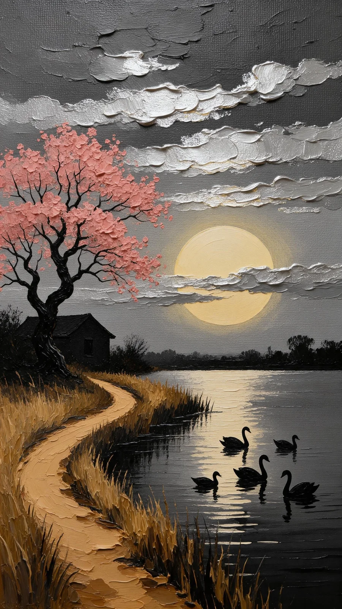

# Impasto Oil-Painting Landscape with Knife Strokes

**中文标题：** 厚涂油画风景（调色刀笔触）  
**ID:** `gi25-x-835` · **Mode:** `generate`  
**Categories:** `general`  
**Tags:** `x-twitter`, `community`, `gpt-image-2.5`, `x-direct`, `en`



### Impasto Oil-Painting Landscape with Knife Strokes

```text
Oil painting style, thick impasto texture with visible palette knife strokes. A serene lake at dusk with a large golden moon partially hidden behind textured grey clouds. Six black swans swimming gracefully on the water, creating gentle ripples. Golden moonlight reflecting on the water surface. Pink cherry blossom tree on the right shore with petals falling slowly. Small cozy house with warm yellow lights in the windows. Dry golden reeds swaying gently in the breeze. Mountains in the distance. Calm, peaceful atmosphere, cinematic lighting, 4k.
```

- **Recommended model:** `gpt-image-2.5-sunburst`
- **Settings:** _(defaults)_
- **Source:** [community](https://x.com/churvikv/status/2107856173839872397) — @churvikv
- **License note:** Original public X post; quoted with attribution — remix with attribution
- **Notes:** Collected directly from X; original post https://x.com/churvikv/status/2107856173839872397; post text names GPT Image 2.5; discovered via Bin0754/gpt-image-gallery index, prompt re-verified against the original X post via api.fxtwitter.com; verified=True
- **Preview:** `previews/gi25-x-835.webp`
